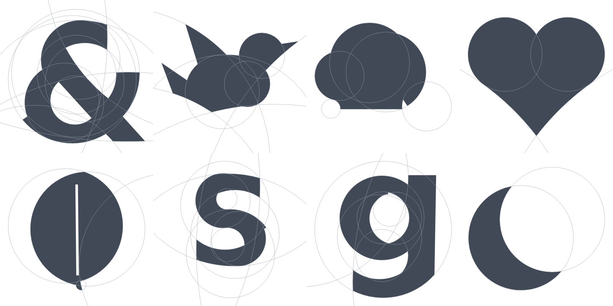
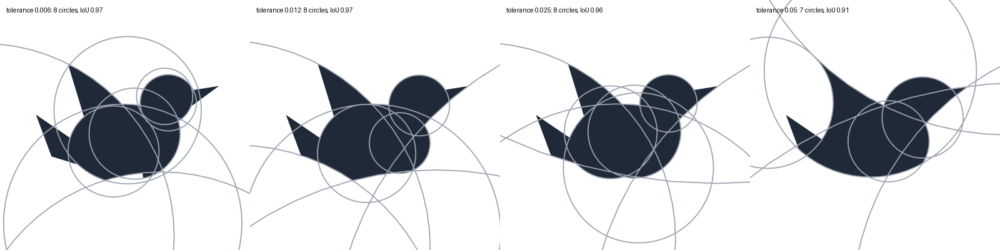

# Lumi

## circlelogo: automatic "circle method" logos

Designers often build simple logos (the classic example is the Twitter bird) by drawing
**every curve as an arc of a circle**. The circles come from a small family whose radii
step by the golden ratio φ ≈ 1.618 (or Fibonacci numbers 1, 2, 3, 5, 8, 13 …). `circlelogo`
does this automatically. Give it an image and it returns a clean vector logo plus the
construction sheet of circles it was built from.



```bash
pip install -r requirements.txt
python -m circlelogo my_shape.png --png            # writes my_shape.logo.svg, .construction.svg, .circles.json, PNGs
python -m circlelogo my_shape.png -t 0.04          # simpler, more stylized
python -m circlelogo my_shape.png -s fibonacci --labels
```

```python
from circlelogo import circleize, to_svg, to_construction_svg
logo = circleize("bird.png", tolerance=0.02, scale="golden")
print(logo.stats)   # {'circles': 8, 'arcs': 8, 'lines': 4, 'iou': 0.96}
open("bird.svg", "w").write(to_svg(logo, color="#0ea5e9"))
```

### How it works

1. **Silhouette**: alpha channel, or an Otsu threshold with automatic inversion. Then
   morphological cleanup and outline tracing, keeping holes.
2. **Corners**: points whose turning angle exceeds `--corner` (40°) become fixed break points.
3. **Fewest arcs (DP)**: between corners, dynamic programming finds the *minimum number*
   of pieces such that each piece stays within `tolerance` of a single circle. Then each
   break point slides to balance the error on both sides.
4. **Snap radii to a scale**: a unit is chosen so the measured radii land as close as
   possible to `R, R/φ, R/φ², …` (or `unit × Fibonacci`). Each arc then picks the
   neighbouring allowed radius that fits best, and its center is refit with the radius fixed.
5. **Reuse circles**: arcs whose snapped circles coincide share one circle, and neighbouring
   arcs on the same circle are fused.
6. **Exact joints**: sharp joints become the true **intersection** of the two circles.
   At smooth joints whose circles barely miss each other, one circle is slid so the two are
   exactly **tangent**, as a designer would draw it.
7. **Output**: an SVG path made only of arcs (`A` commands, even-odd fill for holes), a
   construction SVG showing all the circles, JSON with every circle and arc, and the IoU
   against the traced shape.

### Knobs

| option | effect |
|---|---|
| `-t/--tolerance` (0.012) | max deviation as a fraction of the shape's diagonal. **Higher = fewer circles, simpler logo** (see below) |
| `-s/--scale` | `golden` (default), `fibonacci`, or `free` (no snapping) |
| `--corner` | angle in degrees that counts as a sharp corner |
| `--lines` | allow true straight segments for very flat edges (default: big circles instead) |
| `--no-merge` | don't let different edges share a circle |
| `--invert`, `--threshold` | silhouette extraction control for tricky images |



### Tips / limits

- Works best on **high-contrast silhouettes** (icons, glyphs, cut-out photos). For photos,
  isolate the subject first, e.g. with a background remover that outputs a transparent PNG.
- Golden-ratio snapping is a deliberate stylization. Shapes whose true radii aren't related
  by φ (like the moon sample, radii ratio 1.2) drift visibly. Use `-s free` to keep exact radii.
- Strokes thinner than about 2× tolerance get wobbly. Raise the tolerance or thicken them first.

`python examples/make_inputs.py` regenerates the sample inputs, and
`python -m unittest discover -s tests` runs the tests.
