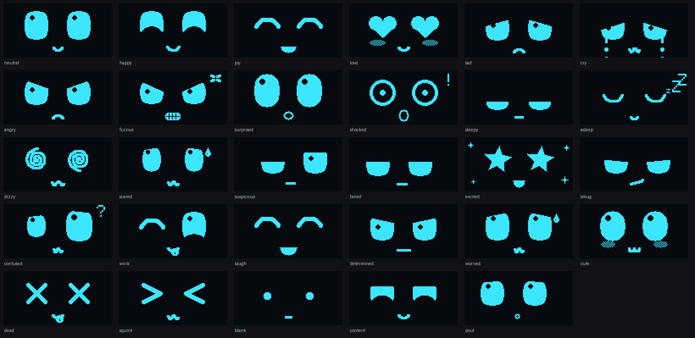
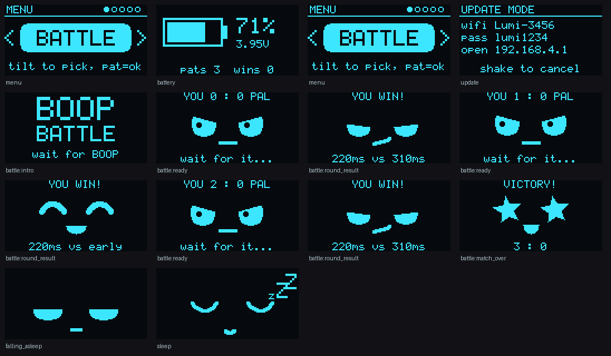

# Lumi

**An open-source, build-it-yourself robot keychain pet.** A tiny glowing face
that feels your pats and shakes, has moods, sleeps when you put it down,
wakes when you pick it up, and plays a 2-player reaction game with a friend's
Lumi over the air.

Lumi is an independent DIY recreation of the *kind* of gadget popularised by
the Rekko NEO keychain. It's built from ~$15 of off-the-shelf modules. It
shares no code, artwork or branding with Rekko and isn't affiliated with it.


| Spec card item | Lumi |
|---|---|
| 0.96" OLED, 128×64, glowing cyan | SSD1306 0.96" 128×64 (blue panel reads as cyan) |
| Motion sensor, 6-axis, feels every pat & shake | MPU-6050: pat, double-pat, pat-spam, shake, drop, tilt, flip, pick-up, put-down |
| ESP32-C3 brain, runs 60+ animations | XIAO ESP32C3 · **66 animations** from 29 parametric expressions, plus blinking, eye-darts and breathing on top |
| 2-player wireless battle | **Boop Battle** over ESP-NOW: reaction duel, best of 5 |
| 500 mAh battery inside | 503030 500 mAh LiPo |
| USB-C rechargeable | XIAO's USB-C + on-board charger |
| Deep-sleeps when idle | ESP32-C3 deep sleep, display off, IMU on wake-on-motion |
| Wakes when you pick it up | MPU-6050 motion interrupt → GPIO3 deep-sleep wake |
| Free animation updates | Wi-Fi update mode: phone → `192.168.4.1` → upload |
| 35 × 37 mm glitter shell | Parametric OpenSCAD case, 35 × 37 × 19.5 mm, print in glitter PLA |

## What it looks like

All 29 expressions (rendered by the real firmware code in the simulator):



Menu, battery, update and Boop Battle screens:



A scripted session: boot, pats, shake, menu, a full battle, falling asleep
([tour.gif](docs/previews/tour.gif)).

## Repository layout

```
firmware/
  platformio.ini            PlatformIO project (XIAO ESP32C3)
  src/                      hardware glue: main.cpp, OLED + IMU drivers, config.h (pins & tuning)
  lib/lumi_core/src/        portable brain, no Arduino dependencies:
    face.*                    parametric face renderer + 29 expressions
    animations.*              66 animations (data tables; add your own here)
    animator.*                tweening, blinking, eye darts, motion layers
    gestures.*                pat / shake / tilt / pickup / freefall detection
    mood.h                    happiness + energy, persisted across deep sleep
    battle.*                  Boop Battle protocol + game state machine
    app.*                     behaviour: modes, menu, sleep rules, screens
    gfx.*                     1-bit framebuffer + 5x7 font
hardware/
  BOM.md · wiring.md
  enclosure/lumi_case.scad  parametric case; stl/ has ready-to-print parts
docs/
  using-lumi.md             gestures, mood, menu, battle, OTA, serial console
  assembly.md               build guide + first-power-up checklist
  previews/                 rendered images
tests/                      desktop tests for the core (make -C tests)
tools/
  sim/                      desktop simulator → PNG/GIF previews
  arduino_build.sh          build with arduino-cli / Arduino IDE instead of PlatformIO
```

## Build the firmware

**PlatformIO** (recommended):

```sh
cd firmware
pio run -t upload        # build + flash over USB-C
pio device monitor       # serial console (type 'h' for commands)
```

**arduino-cli / Arduino IDE** (ESP32 core 2.0.17):

```sh
tools/arduino_build.sh                # compile
tools/arduino_build.sh /dev/ttyACM0   # compile + upload
```

If the XIAO doesn't show up as a serial port, hold **BOOT**, tap **RESET**,
release **BOOT**, then upload again.

## Hack on it without hardware

The behaviour runs on your computer exactly as it does on the device:

```sh
make -C tests                         # 575 checks: gestures, battle protocol, animations, app flows
python3 tools/sim/make_previews.py    # re-render docs/previews (needs Pillow)
python3 tools/sim/make_previews.py --all-gifs   # one GIF per animation in build/sim/gifs
```

Adding an animation is a few lines in `firmware/lib/lumi_core/src/animations.cpp`:
a list of `(expression, gaze, motion, tween ms, hold ms, effects)` keys
plus a table row saying which gesture triggers it and in which mood range.

## How it works (short version)

- **Face**: a face is ~20 numbers (eye size, lids, slant, cheeks, gaze, mouth
  shape…). Expressions are presets, and animations tween between them.
  Blinks, eye darts and breathing are layered on top, so Lumi never looks
  frozen.
- **Gestures**: the MPU-6050 samples at 100 Hz into its FIFO. The firmware
  high-passes the signal. Short sharp bursts are pats, repeated big bursts
  are shakes. Low-passed gravity gives orientation; |a| ≈ 0 is free-fall.
  Tap timestamps come from the FIFO cadence, so they stay accurate even
  while the display is being redrawn.
- **Boop Battle**: ESP-NOW broadcast, no pairing. The Lumi with the higher
  MAC hosts and picks a seed, and both derive identical random delays from
  it. Each Lumi measures its own reaction time locally, so radio latency
  doesn't matter. Every packet carries the full score history, so lost
  packets don't either. The tests play whole matches over a simulated link
  with 40% packet loss.
- **Sleep**: display charge pump off, IMU to low-power cycle mode with a
  latched motion interrupt on GPIO3, ESP32-C3 into deep sleep. Mood lives
  in RTC memory, and the RTC clock tells Lumi how long it slept.

## Status

- ✅ Core logic: 575 automated checks pass (ASan/UBSan clean), including
  two simulated Lumis playing complete Boop Battles through their menus.
- ✅ Firmware compiles and links for the ESP32-C3 (Arduino core 2.0.17,
  `-Wall -Wextra`, no warnings in Lumi's code): 815 KB flash (62% of an OTA
  slot), 43 KB RAM.
- ✅ Case renders to valid STLs at 35 × 37 mm.
- ⚠️ **Not yet tested on real hardware.** Expect to tune the IMU axis map,
  tap threshold and wake sensitivity once it's built (see the checklist in
  `docs/assembly.md`), and to adjust case tolerances after a test print.
- ⚠️ The case is 19.5 mm deep because a stock GY-521 board won't fit beside
  the XIAO. A custom PCB, or a smaller IMU breakout, could get it thinner.

## License

MIT, see [LICENSE](LICENSE).
