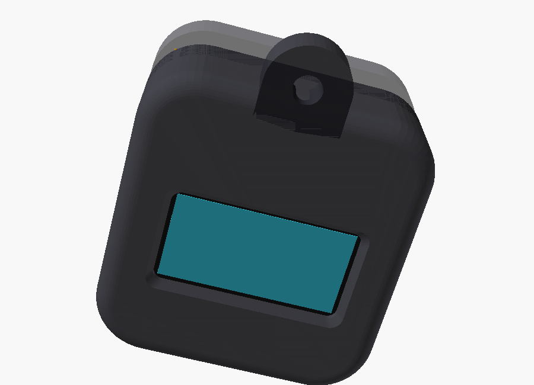

# Building a Lumi

Time: about 1–2 hours plus printing. You need a fine-tip soldering iron,
flush cutters, tweezers and some Kapton tape.

## 1. Print the case

Ready-made STLs are in `hardware/enclosure/stl/`. Or regenerate them from
`hardware/enclosure/lumi_case.scad` (OpenSCAD) after tweaking parameters:

```sh
cd hardware/enclosure
openscad -D 'part="front"' --export-format binstl -o stl/lumi_front.stl lumi_case.scad
openscad -D 'part="back"'  --export-format binstl -o stl/lumi_back.stl  lumi_case.scad
```

- Material: PLA or PETG. Glitter/"galaxy" filament gives the sparkly shell.
- 0.2 mm layers, 3 walls, 20% infill, **no supports**.
- Front half: screen side down on the bed. Back half: outside face down.
- Check the lip fit before assembly. If it's too tight or loose, change
  `fit` (clearance per side, default 0.15 mm) and reprint the back.
- Measure your OLED module. Panels vary by ~0.5 mm, and if the glass isn't
  centred behind the window, adjust `oled_glass_offset_y` / `view_offset_y`.



## 2. Prepare the modules

1. **GY-521:** desolder or carefully scrape off the power LED. Don't fit
   the pin header.
2. **OLED:** if it came with a pin header, desolder it. Flat wires make
   room for the XIAO behind it.
3. **XIAO ESP32C3:** flash it *before* building it in (see the main
   README), and check on the serial monitor that it boots.

## 3. Wire it up

Follow [`hardware/wiring.md`](../hardware/wiring.md). Tips:

- Use 30 AWG wire and keep the leads just long enough to fold the
  layers together.
- Build the 220 k + 220 k divider in the air (or with SMD parts) between
  BAT+, D2 and GND, then sleeve it in Kapton.
- Solder the battery **last**, and double-check polarity on the XIAO's
  BAT+/BAT− pads first. A reversed LiPo will destroy the charger.

## 4. Stack it into the case (front to back)

```
 front ─┐
        │ 1.4 mm  front wall + window
        │ ~2.7 mm OLED (glass into the recess, pins at the top)
        │ ~1 mm   wires, Kapton
        │ ~4.4 mm XIAO (USB-C into the right-hand opening, between the rails)
        │ ~2.6 mm GY-521, chip facing back, Y arrow pointing at the keyring
        │ ~5.4 mm 500 mAh LiPo (in the back half)
        │ 1.4 mm  back wall
 back  ─┘   = 19.5 mm
```

1. Drop the OLED face-down into the front half so the glass sits in its
   recess and the PCB rests against the two pegs. A dot of foam tape
   holds it.
2. Kapton over the back of the OLED.
3. Slide the XIAO in so the USB-C lines up with the side opening.
4. Kapton over the XIAO, then the GY-521 on top. Its orientation matters:
   see the IMU table in `wiring.md`.
5. Route the battery leads through the notch in the lip and press the
   battery into the back half.
6. Close the case. It's a friction fit; add a dot of glue once you're
   happy with it.

## 5. First power-up checklist

- [ ] Face appears and blinks. If not, check SDA/SCL and the serial log
      (`SSD1306 not found`).
- [ ] Serial `i`: hanging from the keyring gives `y ≈ +1`, face-up on a table
      gives `z ≈ +1`. If not, fix the axis map in `config.h`.
- [ ] A pat makes it react. If pats are missed or false-trigger, tune
      `tapThreshold` in `lib/lumi_core/src/gestures.h`.
- [ ] Lay it face-down: it sleeps. Pick it up: it wakes. If it never wakes,
      check the INT wire (D1). If it wakes too easily, raise
      `LUMI_WAKE_THRESHOLD`.
- [ ] Serial `b` shows a sensible battery voltage (3.5–4.2 V).
- [ ] Plug in USB-C: the XIAO charge LED lights.
