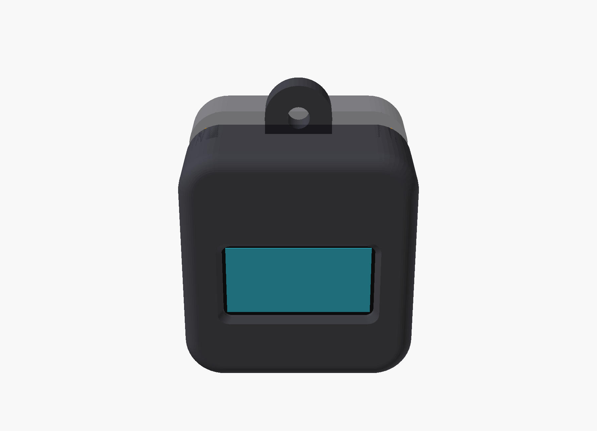

# Building a Lumi

Time: about 1–2 hours plus printing. You need a fine-tip soldering iron,
flush cutters, tweezers and some Kapton tape.

## 1. Print the case

Ready-made STLs are in `hardware/enclosure/stl/`. Or regenerate them from
`hardware/enclosure/lumi_case.scad` (OpenSCAD) after tweaking parameters:

```sh
cd hardware/enclosure
openscad -D 'part="front"' --export-format binstl -o stl/lumi_front.stl lumi_case.scad
openscad -D 'part="back"'  --export-format binstl -o stl/lumi_back.stl  lumi_case.scad
```

- Material: PETG is the better choice: it bends more before it cracks, which suits the snap hooks. PLA hooks may crack after repeated opening. Glitter/"galaxy" filament gives the sparkly shell.
- 0.2 mm layers, 3 walls, 20% infill. **Support only under the keyring tab**
  (support from the build plate is enough), since it's centred on the top
  and stands clear of the bed.
- Front half: screen side down on the bed. Back half: outside face down.
- The four hook arms stand upright on the front half, so they bend across
  their layer lines, which is where a print is weakest. Good layer bonding
  matters more here than anywhere else: print at the hot end of your
  filament's range, keep the part cooling fan moderate (around 30 to 50% for
  PETG), and don't print the front faster than your usual walls.
- **Tune the click first with the snap test** (`stl/snap_test.stl`, one
  plate): three short fronts with hooks 0.25, 0.35 and 0.45 mm deep (the
  depth is engraved underneath) and one back that takes all three. Print it
  in the filament you'll use for the case. Snap each front into the back
  five or six times:
  - **Too deep:** it takes a hard push, or it whitens or cracks at the root of an arm.
  - **Too shallow:** it barely clicks, or falls apart when you shake it.
  - **Just right:** a firm click, and it opens with a fingernail in the side
    notch.
  Set `snap_catch` to the depth that felt right, and print the case.
  Regenerate the test with `-D 'part="snap_test"'`.
- If the lip binds or rattles before the hooks engage, change `fit`
  (clearance per side, default 0.15 mm) and reprint the front, which carries
  the lip.
- Measure your OLED module. Panels vary by ~0.5 mm, and if the glass isn't
  centred behind the window, adjust `oled_glass_offset_y` / `view_offset_y`.



## 2. Prepare the modules

1. **GY-521:** desolder or carefully scrape off the power LED. Don't fit
   the pin header.
2. **OLED:** if it came with a pin header, desolder it. Flat wires make
   room for the XIAO behind it.
3. **XIAO ESP32C3:** flash it *before* building it in (see the main
   README), and check on the serial monitor that it boots.

## 3. Wire it up

Follow [`hardware/wiring.md`](../hardware/wiring.md). Tips:

- Use 30 AWG wire and keep the leads just long enough to fold the
  layers together.
- Build the 220 k + 220 k divider in the air (or with SMD parts) between
  BAT+, D2 and GND, then sleeve it in Kapton.
- Solder the battery **last**, and double-check polarity on the XIAO's
  BAT+/BAT− pads first. A reversed LiPo will destroy the charger.

## 4. Stack it into the case (front to back)

```
 front ─┐
        │ 1.4 mm  front wall + window
        │ ~2.7 mm OLED (glass into the recess, pins at the top)
        │ 2.2 mm  the OLED's back parts, wires, BAT pads, Kapton
        │ ~4.4 mm XIAO (USB-C into the right-hand opening, between the rails)
        │ 1.3 mm  Kapton, the GY-521's solder joints
        │ ~2.6 mm GY-521, chip facing back, Y arrow pointing at the keyring
        │ 1.5 mm  battery leads, divider resistors
        │ ~7.4 mm 300 mAh 702025 LiPo (in the back half)
        │ 0.6 mm  foam, or a folded scrap of paper (no hot glue on the cell)
        │ 1.4 mm  back wall
 back  ─┘   = 25.5 mm
```

1. Drop the OLED face-down into the front half so the glass sits in its
   recess and the PCB sits in its pocket. A dot of foam tape holds it.
2. Kapton over the back of the OLED.
3. Slide the XIAO in so the USB-C lines up with the side opening. Its PCB
   rests on the ledges beside the USB-C, and the stop at its far end takes
   the push of a plug.
4. Kapton over the XIAO, then the GY-521 on top, with its edge on the two
   ribs on the left wall. Its orientation matters: see the IMU table in
   `wiring.md`.
5. Stick the battery into the back half with foam tape. Route its leads
   through the notch in the lip on the left, and keep every wire clear of
   the four snap arms on the top and bottom walls.
6. Line up the halves and press until all four hooks click. No glue or
   screws. To open it, put a fingernail in the notch in the seam on the left
   side and work the halves apart. Don't use anything sharp: the battery is
   just inside.

## 5. First power-up checklist

- [ ] Face appears and blinks. If not, check SDA/SCL and the serial log
      (`SSD1306 not found`).
- [ ] Serial `i`: hanging from the keyring gives `y ≈ +1`, face-up on a table
      gives `z ≈ +1`. If not, fix the axis map in `config.h`.
- [ ] A pat makes it react. If pats are missed or false-trigger, tune
      `tapThreshold` in `lib/lumi_core/src/gestures.h`.
- [ ] Lay it face-down: it sleeps. Pick it up: it wakes. If it never wakes,
      check the INT wire (D1). If it wakes too easily, raise
      `LUMI_WAKE_THRESHOLD`.
- [ ] Serial `b` shows a sensible battery voltage (3.5–4.2 V).
- [ ] Plug in USB-C: the XIAO charge LED lights.
