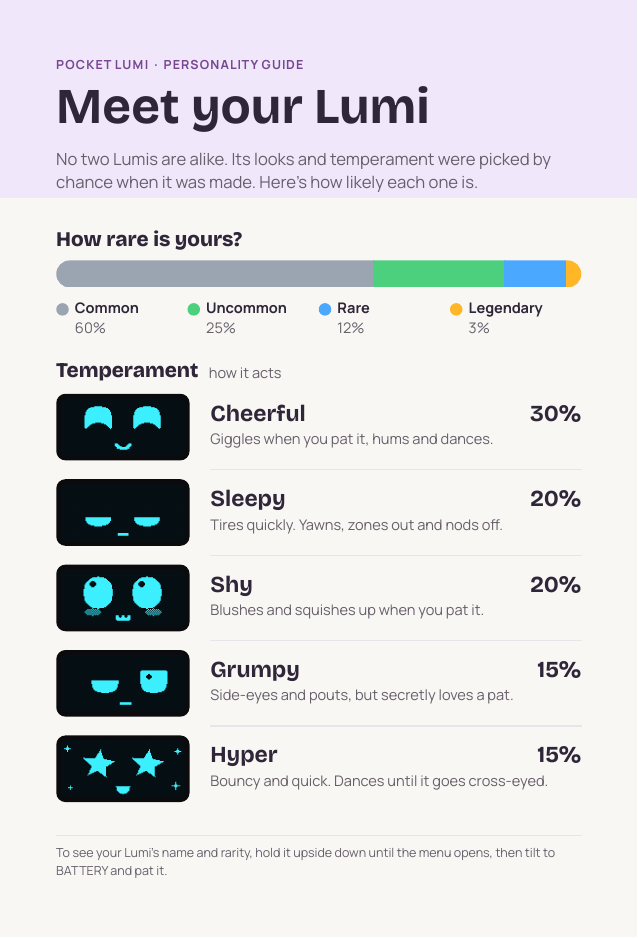
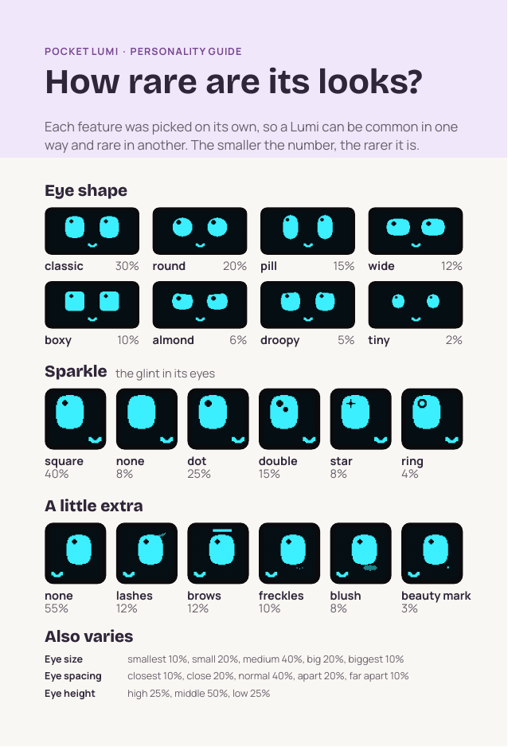

# Printable personality-odds card

A 4 × 6 in card to put in the box with each Lumi. It shows how likely every
rarity, temperament and look is, so the owner can see how lucky they got.

| Front | Back |
|---|---|
|  |  |

Every number comes from the firmware's gene weights, and every face is drawn by
the firmware's own face engine.

## Print it at home

Use [`lumi-odds-card-letter.pdf`](lumi-odds-card-letter.pdf): two cards per Letter sheet.

1. Load card stock: 65–110 lb cover (about 175–300 gsm), or plain paper to try it first.
2. Print with these settings:
   - **Actual size / 100%** (not "Fit to page"),
   - **Double-sided**, **flip on long edge**.
3. Cut on the marks: two cuts across, two down. A paper trimmer gives the cleanest edges.

Before a big run, print one sheet on plain paper and hold it up to a window to
check the backs line up with the fronts. If your printer can't print double-sided,
print page 1, put the sheet back in the tray face down with the top edge going in
first, and print page 2.

## Print shop

Send [`lumi-odds-card.pdf`](lumi-odds-card.pdf):
- 2 pages (front, back),
- 4 × 6 in trim with 0.125 in bleed (4.25 × 6.25 in pages),
- fonts embedded.

Ask for "4 × 6 postcard, double-sided, 14–16 pt card".

## Rebuild it

The card updates itself when the gene weights change. Rebuild it either way:
- **Lumi Studio:** Factory batch tab → **Export odds card…**,
- **Command line:** `python tools/studio/odds_card.py` (needs liblumicore; see [studio.md](../studio.md)).
