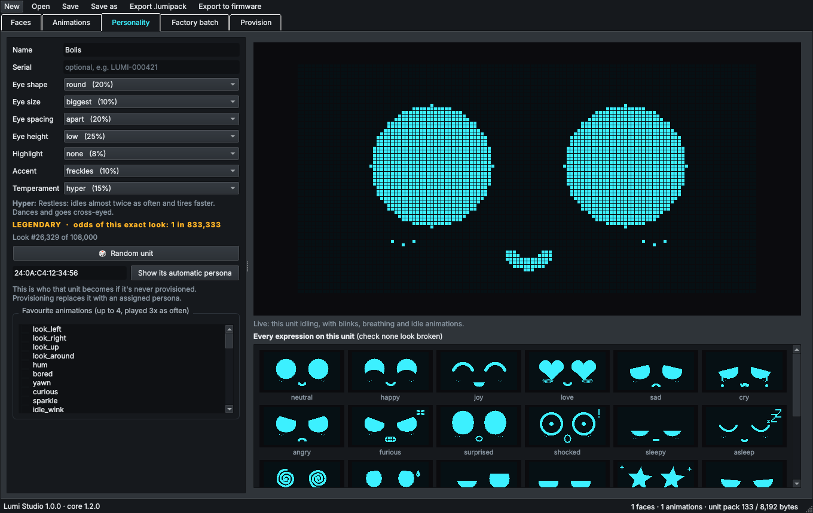
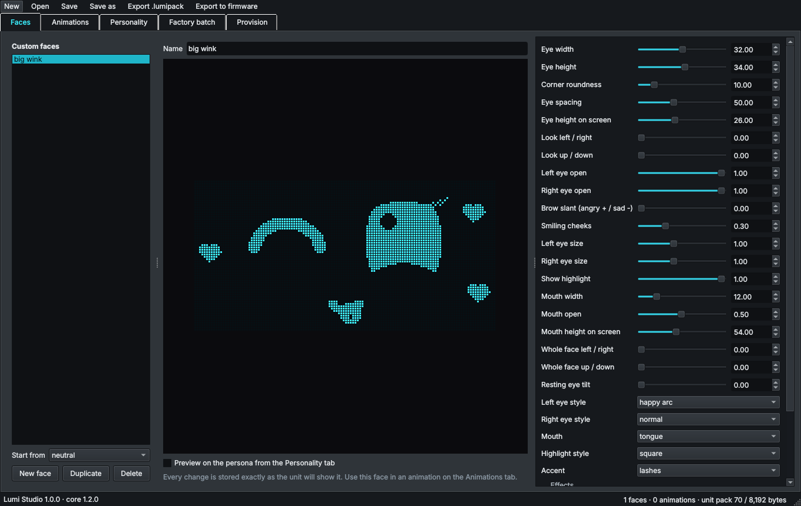
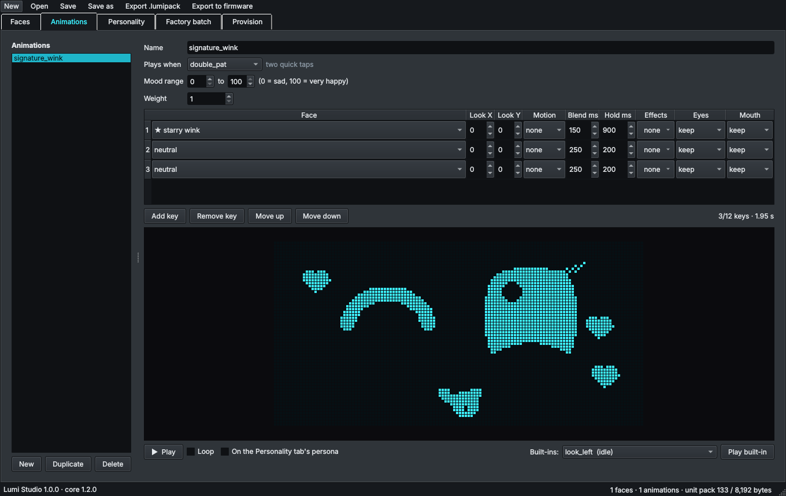
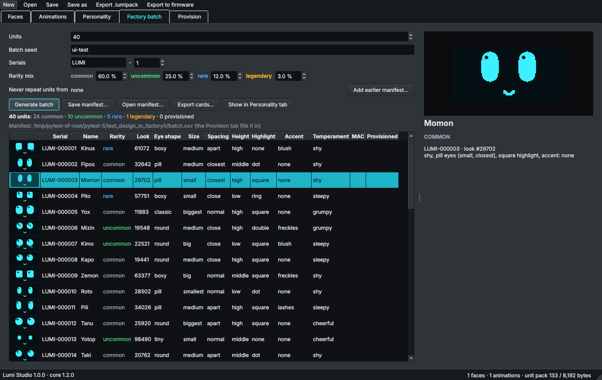
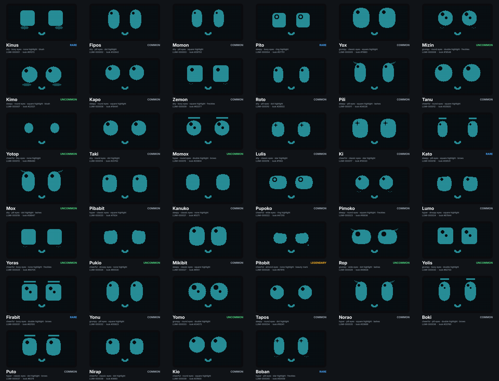
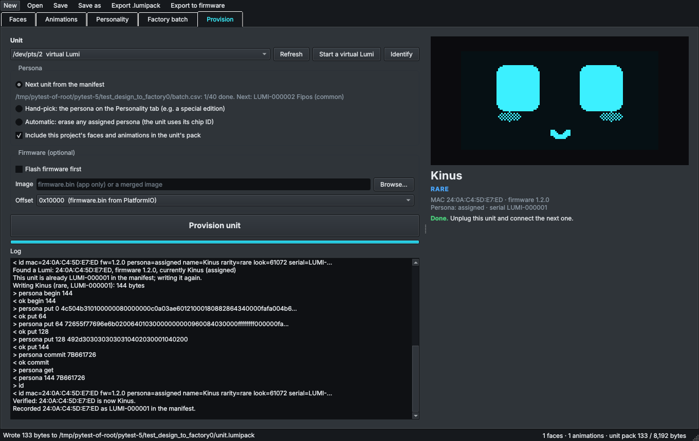

# Lumi Studio: emotions and one-of-a-kind units

Lumi Studio is a desktop app for people who **make** Lumis. Use it to:

- design new faces and animations,
- build them into the firmware, or put them on single units,
- give every unit its own look, name and temperament, with rarity tiers.

The app draws with the firmware's own face engine (compiled into
`liblumicore`), so what you see on screen is what the unit shows, pixel for
pixel.



## How a unit gets its personality

Every Lumi has **genes**. These are seven traits, each picked from a short
list of options:

| Gene | Options | What it changes |
|---|---|---|
| Eye shape | classic, round, pill, wide, boxy, almond, droopy, tiny | width, height, corner roundness, resting tilt |
| Eye size | smallest … biggest (5) | scales the eyes |
| Eye spacing | closest … far apart (5) | distance between the eyes |
| Eye height | high, middle, low | where the eyes sit |
| Highlight | square, none, dot, double, star, ring | the glint in each eye |
| Accent | none, lashes, brows, freckles, blush, beauty mark | a little extra |
| Temperament | cheerful, sleepy, shy, grumpy, hyper | starting mood, how fast it tires, how often it idles, favourite animations |

That makes **108,000 combinations**. Each option has a weight: common options
are picked often and rare ones seldom. A unit's **rarity** comes from how
likely its whole combination is. With the default weights, units come out
about **60% common, 25% uncommon, 12% rare and 3% legendary**.

All 29 expressions are adjusted for each unit's genes, so a surprised unit
with droopy eyes still looks surprised, just in its own way.

A unit's personality comes from one of two places:

1. **Automatic (default).** A unit that was never provisioned builds its
   genes and name from its chip's MAC address. This needs no setup, and a
   unit always comes out the same. Looks do repeat, though, because common
   options come up often: 100,000 automatic units show only about 35,000
   different looks.
2. **Assigned at the factory.** Studio writes a persona to the unit over USB.
   Factory batches never repeat a look or a name, and you can hand-pick
   special editions.

The unit shows its name and rarity on the battery screen (menu → battery).

## Install

**Download:** get the latest version from the repository's
[**Releases** page](https://github.com/belivablelevi/Lumi/releases/latest).

On **Windows**:
1. Download `LumiStudio-Windows.zip`.
2. Right-click it and choose **Extract All**.
3. Double-click `LumiStudio.exe`.
4. The app isn't code-signed yet, so the first time Windows may show "Windows protected your PC". Click **More info**, then **Run anyway**.
5. To set up a real Lumi, plug it in with a USB-C data cable and pick its port on the **Provision** tab. No driver is needed: the ESP32-C3 shows up as a USB serial port.

On **Mac**:
1. Download `LumiStudio-macOS.zip` and unzip it.
2. The first time, right-click **LumiStudio**, choose **Open**, then **Open** again.

On **Linux**: extract `LumiStudio-Linux.tar.gz` and run `./LumiStudio`.

New versions are published by pushing a tag like `studio-v0.2.0`, or from the Actions tab: **studio-release → Run workflow**.

**Latest build without a release:** the artifacts of the newest CI run (Actions → ci → *LumiStudio-…*).

**From source** (any OS with Python 3.9+ and a C++17 compiler):

```sh
cmake -S tools/studio -B build/studio -DCMAKE_BUILD_TYPE=Release
cmake --build build/studio --config Release
pip install -r tools/studio/requirements.txt
python tools/studio/run_studio.py
```

To build a one-file app yourself: `pip install pyinstaller && python tools/studio/package.py`.
The app lands in `build/studio/dist/`.

## 1. Faces



Pick a built-in expression under **Start from** and press **New face**. Every
parameter has a slider:

- eye size, roundness and spacing,
- each lid's openness,
- brow slant, cheeks, gaze and mouth,
- eye and mouth styles, highlight style, accent,
- overlay effects (hearts, sparkles, zzz…).

Values snap to what the unit can store, so the preview is exact. Tick
**Preview on the persona** to see the face with the genes from the
Personality tab.

## 2. Animations



An animation is a list of up to 12 **keys**. Each key has:

- a face (built-in, or ★ one of yours),
- a gaze offset,
- a body motion (hop, shake, bounce…),
- a blend time and a hold time,
- optional effects and eye or mouth overrides.

**Plays when** picks the gesture that triggers the animation, such as a tap,
a double tap, a shake or being picked up. **Mood range** limits it to a
happy or a sad Lumi. **Weight** sets how often it plays next to other
animations for the same trigger.

Press **Play** to run it through the firmware's real animator, with blinks
and breathing. You can also play any built-in animation for reference.

## 3. Personality

Edit the genes directly, or press **Random unit**. The tab shows:

- the rarity, and the odds of getting exactly this look,
- a live idling preview,
- all 29 expressions on this unit, so you can check none of them look
  broken.

Type a chip MAC and press **Show its automatic persona** to see who an
unprovisioned unit will be. To try it, use one of these:

| MAC | Name | Rarity |
|---|---|---|
| `24:0A:C4:EE:7F:1A` | Fi | common |
| `24:0A:C4:6E:D0:8F` | Boko | uncommon |
| `24:0A:C4:82:B7:0E` | Nobu | rare |
| `24:0A:C4:D4:54:4A` | Kabu | legendary |

**Favourite animations** (up to 4) play three times as often on this unit.

## 4. Factory batch



Choose how many units, a **batch seed**, a serial prefix and starting
number, and the rarity mix. Then press **Generate batch**.

- Every unit gets a different look and a different name.
- The same seed and settings always give the same batch, so a lost manifest
  can be regenerated.
- **Never repeat units from** reads earlier manifests, so a new batch avoids
  every unit you've already made.

**Save manifest** writes a CSV with these columns: serial, name, rarity,
look, every gene, MAC and provisioning time. Provisioning fills in the
last two. **Export cards** writes one PNG card per unit, ready for box
inserts, plus a contact sheet:



**Export odds card** writes the personality-odds insert for the box: a 4 × 6 in
two-sided card showing how likely each rarity tier, temperament, eye shape,
highlight and accent is. You get one PDF for a print shop and one with two cards
per Letter sheet for home printing. The odds come from the firmware's gene
weights, so re-export after you change them. See [print/](print/README.md).

## 5. Provision



1. Plug a unit in over USB-C and pick its port. **Identify** shows its MAC,
   firmware version and current persona.
2. Choose what to write:
   - **Next unit from the manifest.** This is the normal production line.
     If the unit is already in the manifest, it gets the same persona again,
     so re-provisioning is safe.
   - **Hand-pick** writes the persona from the Personality tab, for example
     a special edition. If a manifest is open, the unit is added to it.
   - **Automatic** erases the assigned persona, and the unit goes back to
     its MAC-based one.
3. Optionally tick **Flash firmware first** and choose a `firmware.bin`
   (offset 0x10000) or a merged image (offset 0x0).
4. Press **Provision unit**. Studio writes the pack, reads it back, checks
   the CRC, and asks the unit to confirm its new name and look. Only then
   does it record the MAC in the manifest. If a unit that already had a
   persona is given a different one, its old manifest row is freed.

**Start a virtual Lumi** (macOS/Linux) runs the real firmware code on a
pretend serial port, so you can try all of this without hardware.

## Shipping emotions

| To put your faces and animations on… | Do this |
|---|---|
| **every unit** | **Export to firmware…** writes `firmware/lib/lumi_core/src/generated/default_pack.h`. Rebuild and flash the firmware. |
| **one unit** | Keep **Include this project's faces and animations** ticked when provisioning. They are stored with the persona. |
| **a file** | **Export .lumipack** writes the project and the current persona as one pack file. |

Limits per pack: 32 custom faces, 32 animations, 12 keys per animation, 8 KB
in total. The status bar shows how big the pack is.

Projects save as `.lumiproject` (JSON), which works well in git.

## Pack format and serial protocol

See `firmware/lib/lumi_core/src/pack.h` for the pack format and
`serial_cmd.h` for the protocol. The protocol is plain text at 115200 baud,
so other factory tools can use it too:

```
id                        -> id mac=24:0A:C4:12:34:56 fw=1.2.0 persona=auto name=Rotoko rarity=common look=... serial=-
persona begin <bytes>     -> ok begin <bytes>
persona put <off> <hex>   -> ok put <next offset>
persona commit <crc32>    -> ok commit | err crc mismatch (got ...) | err <reason>
persona get               -> persona <bytes> <crc32>, data <off> <hex> ..., end   (or: persona none)
persona clear             -> ok clear
```

The unit checks every pack with the same decoder the app uses. If a pack is
damaged or invalid, the unit rejects it and keeps its current persona.

## Status

- Tested here: the app's logic and every tab (automated, offscreen), and
  provisioning end to end against a virtual Lumi running the real
  firmware code.
- **Not yet tested:** real USB hardware, and the Windows and macOS builds
  (CI builds and starts them on each push). Expect small fixes on the first
  real production run.
