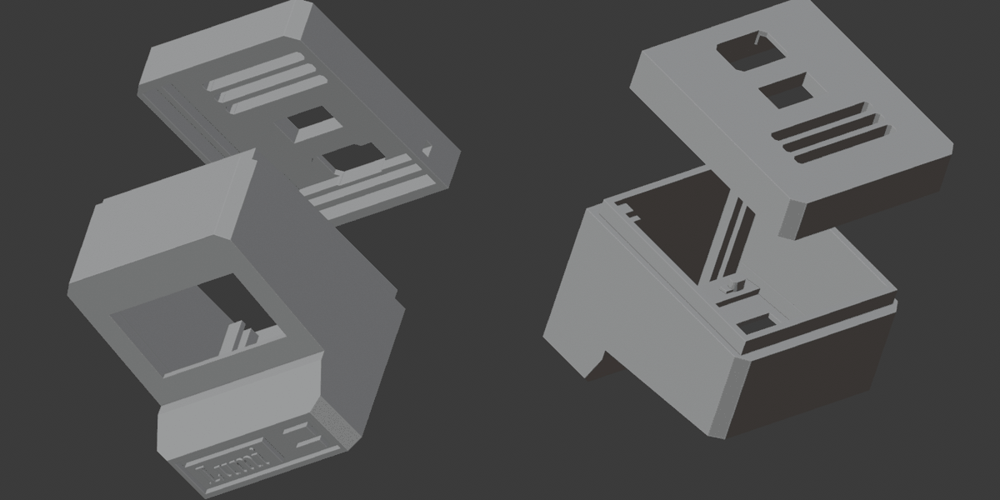
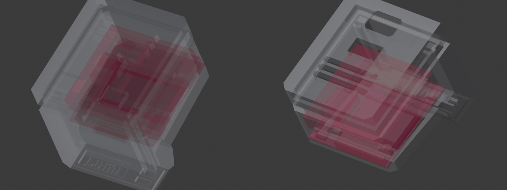

# Mini Lumi 2: alternative case (untested)

A desk-toy style case: a little retro computer with the screen in a tilted
bezel and a "Lumi" badge on the chin. **Not printed or tested yet.**

[`mini_lumi2.stl`](mini_lumi2.stl) holds two parts side by side, already
in the Blender reference axes (X right, Z up, −Y toward you; millimetres):

| Part | Size (W × D × H) | Notes |
|---|---|---|
| Body | 35.0 × 32.7 × 40.5 mm | Open at the back. The "Lumi" letters are separate raised pieces on the chin. |
| Lid | 35.0 × 8.0 × 40.5 mm | 3 mm plate plus a 5 mm rim that carries on the body's walls. Move it −22.65 mm in Y to close the body. |

Assembled, it's about **35 × 41 × 40.5 mm** (W × D × H). The mesh is clean: closed, with no holes or loose edges.

## Measured from the model

| | |
|---|---|
| Inside | 30.2 mm wide (X ±15.1), 34.5 mm tall (Z 2.1–36.6), ~19.3 mm deep from the bezel to the back edge, plus the lid's 5 mm rim |
| Walls | 2.4 mm sides, 3 mm floor and roof |
| Screen window | 26.75 × 14.5 mm, Z 17.0–31.25. The bezel is ~1 mm thick and leans back about 6° (Y −7.9 at the bottom, −6.1 at the top). |
| Behind the bezel | Two clips at the top (Z 32.3–34, X ±3–12.5), up to 3.5 mm behind the bezel. Rails along both sides of the floor, up to Z ≈ 6.2. |
| Lid openings | 11 × 7 mm at Z 3–10, with a 1.5 mm-deep recess around it (a plug recess?) · 10.75 × 5.75 mm at Z 14–19.75 · three vent slots 21 × 2 mm |

## Fit check against the Lumi parts

Checked in Blender with [`../../blender/check_fit.py`](../../blender/check_fit.py). Red in the picture means a part touches the case.

| What | Result |
|---|---|
| **Bare OLED glass** (26.7 × 19.3 mm) behind the bezel | ✅ Fits under the top clips if its top edge stays below Z ≈ 32. The active area then sits inside the window. |
| **Today's OLED module** (27.8 mm-tall board) | ❌ Its board runs into the top clips whichever way up it goes. Shorten or remove the clips, or use a bare panel. |
| **503030 battery**, nominal 30.0 mm | ⚠️ Fits on top of the floor rails with only ~0.1 mm per side and ~0.25 mm at the top. Pouch cells vary by ±0.5 mm. |
| **503030 battery**, 30.2 mm (with swelling allowance) | ❌ Touches the side walls |
| **Lumi PCB v1** (31 × 33 mm board) | ❌ 0.8 mm too wide for the 30.2 mm inside. With the screen centred in the window it also hits the roof. Its USB-C and switch point sideways, but this case only has openings in the lid. |

**Done:** [`../../mini_lumi_pcb/`](../../mini_lumi_pcb/README.md) is this design grown to fit the PCB, generated by a script. The notes below explain why it had to change.

To make it work for the PCB:
- widen the body by ~1.5 mm, or shrink the board to 29.5 mm,
- add a USB-C opening on the left wall and a switch slot on the right, using the **Openings** boxes from the references,
- leave about 0.5 mm per side around the battery.

## Trying it in Blender

1. Run [`../../blender/lumi_refs.py`](../../blender/README.md). This sets millimetres and loads the reference parts.
2. **File > Import > STL** `mini_lumi2.stl`.
3. With the import selected:
   - press Tab for Edit Mode,
   - choose **Mesh > Clean Up > Merge by Distance**,
   - choose **Mesh > Separate > By Loose Parts**,
   - press Tab back to Object Mode.
4. Move the lid −22.65 mm in Y, and put the body, lid and letters in the **Case** collection.
5. Move **Lumi PCB v1 origin** to where the board should sit, then run `check_fit.py`.
