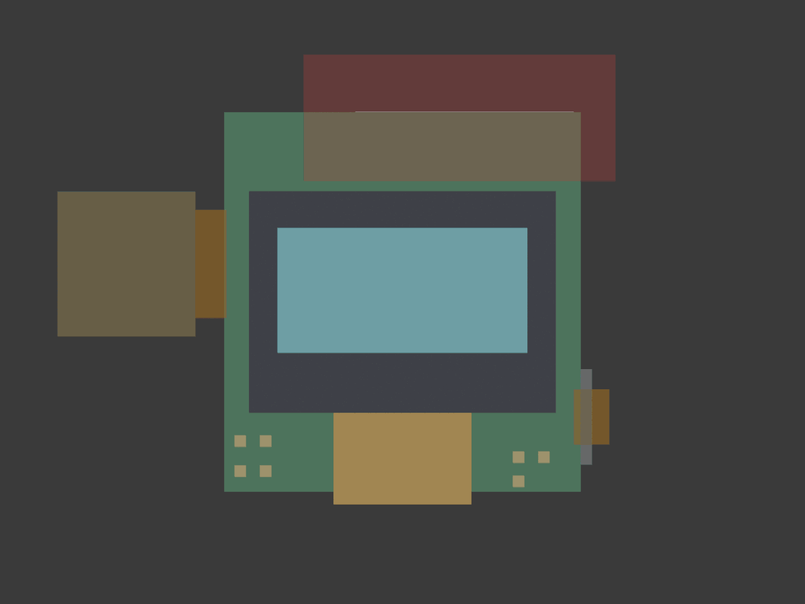
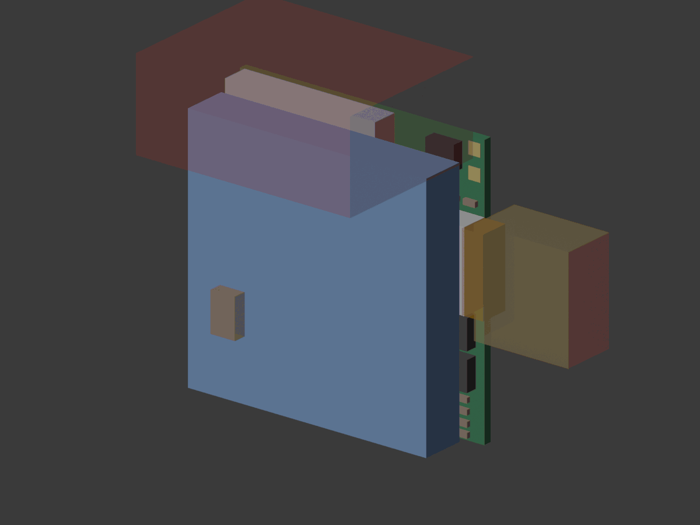

# Modelling the Lumi case in Blender

Everything here is set up so a case for the **Lumi PCB** can be modelled in
Blender (4.2 or newer; tested with 5.0) around the real board. It replaces
guessing dimensions with the board's own measurements.

The case for today's hand-wired build is still the OpenSCAD model in
[`../lumi_case.scad`](../lumi_case.scad). Its printed parts are in
[`../stl/`](../stl/), and you can import those into Blender as a starting
shape.

| Front (screen side) | Back (parts side) |
|---|---|
|  |  |

## Quick start

1. Open Blender. Delete the default cube (select it, press X).
2. Open the **Scripting** workspace, then **Open** `lumi_refs.py` from this folder and press **Run Script** (▶).
3. Press **Numpad 1** for the front view and **Home** to frame everything.

You now have:

- **Scene units set to millimetres.** One Blender unit is 1 mm, so a 35 mm wide case is 35 units wide and exports to STL at the right size.
- **A collection "Lumi PCB v1 (reference)"** with:

  | Group | What's in it |
  |---|---|
  | Board | The 31 × 33 × 1.0 mm PCB |
  | Parts | Every part as a box at its real height. The module and USB-C socket are the tallest, ~3.2 mm. |
  | Screen | The OLED glass, its active area (where the pixels are), and the cable that wraps round the bottom edge |
  | Battery | The 503030 LiPo pouch, behind the parts |
  | Openings | The USB-C opening and the room a plug needs; the power switch's lever slot (wireframes) |
  | Keep-outs | The **antenna zone** (red wireframe): keep metal, screws, magnets and the battery out of it |
  | Today's case outline | The current case's outer and inner shape, for comparison |
- **A handle, "Lumi PCB v1 origin"** (an arrows empty), parent of every reference. Move or rotate it to place the whole stack inside a case. Re-running the script keeps where you put it.
- **An empty "Case" collection**, made active. Anything you add goes there, apart from the references.

Each reference object carries a note: select it and look under **Object Properties > Custom Properties**. Running the script again refreshes the references and never touches **Case**.

**No scripts?** Use **File > Import > Wavefront (.obj)** on `lumi_pcb_v1_refs.obj`. It contains the same boxes. First set **Scene Properties > Units > Unit Scale** to 0.001 and **Length** to Millimeters.

## Axes

| | |
|---|---|
| X | right, seen from the front |
| Z | up, toward the keyring |
| −Y | toward you; the screen faces −Y |
| Origin | centre of the board, on its front face |

So the screen glass is at negative Y and the parts and battery at positive Y. The case wall in front of the glass starts at Y ≈ −1.45.

## What the case has to solve

The generator checks the references against today's case shape and the plan, and lists these problems (also stored in `lumi_pcb_v1_refs.json` under `warnings`):

1. **Corners.** Today's case has 7 mm rounded corners, so its inside corners are 5.6 mm round. The board's square corners and the module's top corners stick out through them. Either:
   - give the PCB case smaller corners (about 4 mm radius outside), or
   - round the board's corners, which means re-placing a few parts.
2. **Depth.** The inside stack is ~14.6 mm with 1.4 mm walls, not the plan's 12.5 mm. The module and USB-C socket are 3.2 mm tall. See [`../../pcb/GUIDE.md`](../../pcb/GUIDE.md) for ways to get it thinner.
3. **Battery vs antenna.** A 30 mm cell behind a 33 mm board reaches about 4.6 mm into the antenna zone, so expect some range loss. Options:
   - a shorter cell,
   - a case a few millimetres taller, with the battery below the antenna line,
   - accept it and test the range at bring-up.
4. **Screen cable.** It wraps round the board's bottom edge. Leave about 1 mm below the board for the bend. The cable size and the active-area position are typical values until the panel's drawing is checked.

## Checking a case

Put the case's mesh objects in the **Case** collection. Move the **Lumi PCB v1 origin** handle (the arrows empty) so the reference stack sits where the board goes, then run `check_fit.py`. It lists:
- every part, the board, the screen or the battery that runs into the case,
- every opening the case blocks (USB-C, switch lever).

It also colours them red. Modifiers count, so a Solidify or Boolean is checked as it will print.

[`../alternatives/mini_lumi2/`](../alternatives/mini_lumi2/README.md) is a worked example.

## Tips for modelling

- **Shell.** Start from a rounded box (Add > Mesh > Cube, then a **Bevel** modifier for the corners) and hollow it with a **Solidify** modifier (1.4 mm, like today's case). Keep modifiers live until you export.
- **Openings.** Make a cube matching each **Openings** box (snap to it with **Shift+S > Cursor to Selected**). Cut it from the shell with a **Boolean** modifier set to **Difference**.
- **Two parts.** Split front and back where the stack allows (between the board and the battery), with a 1.6 mm lip like the OpenSCAD case: 0.15 mm fit clearance per side, tuned for your printer.
- **Checking.** Use **X-ray** (Alt+Z) to check the shell clears every reference box. **Measure** (in the toolbar) reads millimetres directly.
- **Printing.**
  1. Select the case objects.
  2. **File > Export > STL**, tick **Selection Only** and **Apply Modifiers**, leave Scale at 1.0. Units come out in millimetres.
  3. Check the size in the slicer: today's case is 35 × 37 mm.

## Updating the references

The JSON and OBJ are generated from the KiCad board. After the board changes, rebuild them:

```sh
python3 hardware/pcb/kicad/case_refs.py hardware/pcb/kicad/lumi hardware/enclosure/blender
```

`hardware/pcb/kicad/build.sh` does this too.

To refresh the preview pictures:

```sh
blender --background --python hardware/enclosure/blender/render_preview.py
```

| File | |
|---|---|
| `lumi_refs.py` | Blender script: units, reference collection, empty Case collection |
| `lumi_pcb_v1_refs.json` | The reference boxes, outlines and warnings (generated) |
| `lumi_pcb_v1_refs.obj`, `.mtl` | The same boxes for a plain OBJ import (generated) |
| `check_fit.py` | Checks the Case collection against the references |
| `render_preview.py` | Renders `preview_front.png` and `preview_back.png` |
