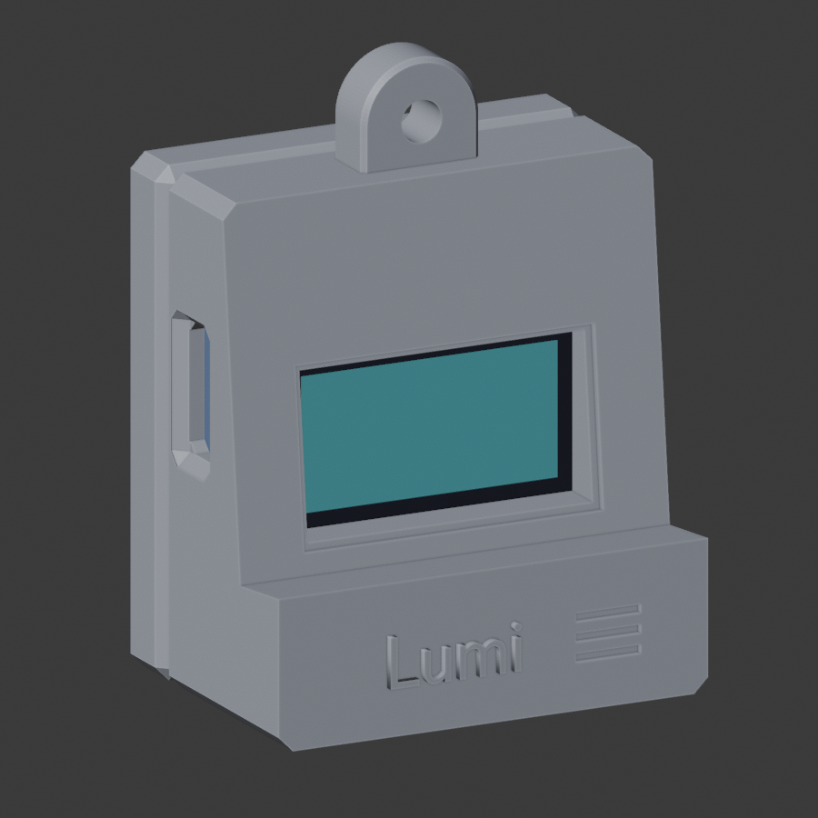
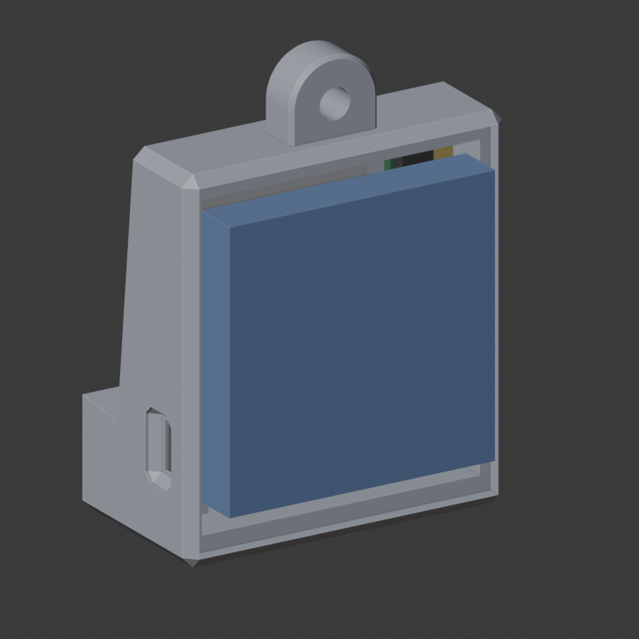
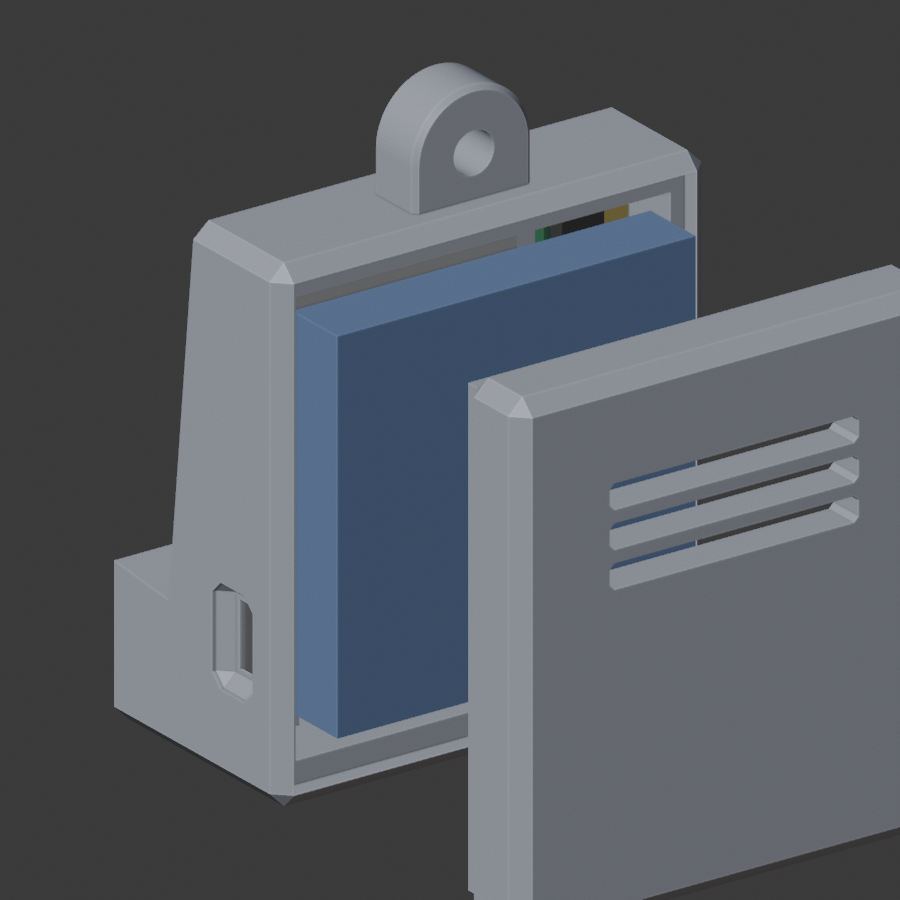

# Mini Lumi (PCB version)

The Mini Lumi desk case from [`../alternatives/mini_lumi2/`](../alternatives/mini_lumi2/README.md), grown to fit the Lumi PCB v1.

It's generated by [`../blender/mini_lumi_case.py`](../blender/mini_lumi_case.py) from the board's reference sizes, so it follows the board when that changes. **Not printed yet.**

| Front | Open back | Lid off |
|---|---|---|
|  |  |  |

## Size

| | Mini Lumi 2 (original) | Mini Lumi PCB |
|---|---|---|
| Outside (W × D × H) | 35 × 41 × 40.5 mm | **36.4 × 26.9 × 49.3 mm** with the keyring tab (40.8 mm without) |
| Inside | 30.2 × ~19 × 34.5 mm | 31.6 × 12.5 × 34.8 mm |
| Screen window | 26.75 × 14.5 mm | 24.1 × 13.3 mm, centred on the screen's active area |
| Openings | two in the lid | USB-C in the left side (with a plug recess), switch slot and finger pocket in the right side |
| Keyring | none | 10 mm wide, 5 mm thick tab, centred on top, with a 3.4 mm hole running front to back |

It's 1.4 mm wider and much shallower than the original: the PCB stack (screen, board, parts, battery) needs only ~12.5 mm.

Kept from the original:
- the chin with a raised **Lumi** badge and three grooves,
- the bezel leaning back 6° with a stepped frame around the window,
- the chamfered edges,
- a lid with three vent slots.

## What holds what

- **Screen:** the glass rests on the back of the bezel. The board sits right behind it.
- **Board:**
  - its front edges rest on two **ledges** beside the glass,
  - its bottom edge stands on two **posts**,
  - the space under it (0.4 mm plus the posts) leaves room for the screen cable's bend.
- **Battery:**
  - sits behind the parts, with 0.5 mm around it,
  - 1 mm of foam tape between the battery and the lid presses the whole stack forward.
- **Lid:** slides into a 1.5 mm lip joint (0.15 mm clearance per side). It's a press fit; add a dot of glue if it's loose.
- **Antenna:** nothing in the antenna zone (top of the board) but the plain plastic roof and walls. The tab holds the metal ring just above the keep-out zone. The hole's lowest point is 0.1 mm clear of it, and the build fails if it dips into the zone. Metal this close can still affect the radio, so check the range with a ring and keys attached.

`check_fit.py` confirms that no board part, screen, cable or battery touches the case, and that the USB-C and switch openings are clear.

## Printing

| File | Orientation | Notes |
|---|---|---|
| `mini_lumi_pcb_body.stl` | As exported: base on the bed, open back up | No supports needed. The roof inside (31.6 mm) and the window top bridge, and the keyring hole prints as a small sideways hole. |
| `mini_lumi_pcb_lid.stl` | As exported: outside face down | No supports |

- **Settings:** PLA or PETG, 0.2 mm layers, 3 walls, 15–20% infill.
- **Material:** about 17 g for both parts (13.6 cm³ of solid).
- **Strength:** printed this way, the tab's layers run across the pull of the keyring, which is plastic's weakest direction. Pull-test the first print before trusting it on keys.
- **First print:** check the lid fit, the USB-C plug reach and that your split ring threads through the hole. The overmould should sit in the recess with the plug fully home. Adjust `fit` and the recess depth in the script if needed.

## Changing it

The sizes are parameters at the top of `mini_lumi_case.py`: wall, floor, clearances, bezel lean, chin, lid, keyring tab. Re-run it:

```sh
blender --background --python hardware/enclosure/blender/mini_lumi_case.py -- --previews
```

It rebuilds both parts and re-runs the checks. It stops with an error if the case isn't a closed solid or anything collides. It writes the STLs, `mini_lumi_pcb.blend` (case and references, assembled), `sizes.json` and the preview pictures.
