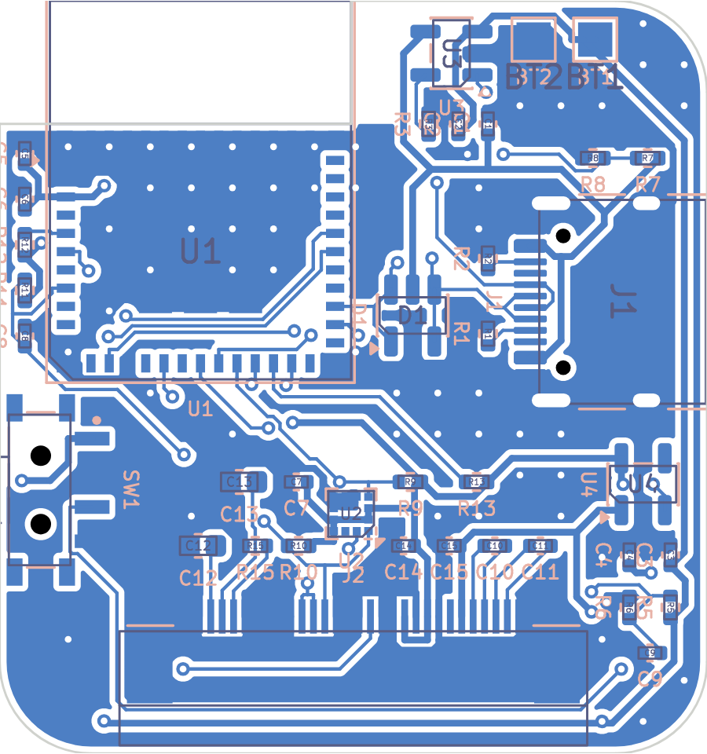
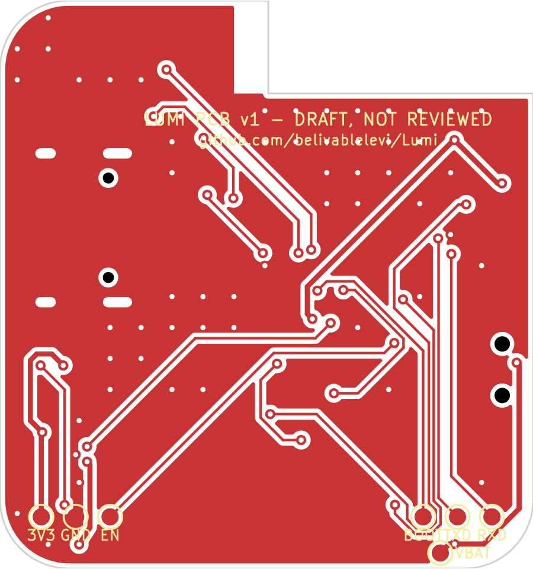

# Lumi PCB v1: draft board, review checklist, ordering and bring-up

> **Status: DRAFT, NOT REVIEWED. Don't order yet.**
>
> Rebuilt in KiCad 10 on 2026-11-05: the module is now the plan's smaller
> ESP32-C3-MINI-1, every part was checked against the factory's own data,
> and the faults listed under [Fixed from the datasheets](#fixed-from-the-datasheets)
> are corrected.
>
> These files were generated and checked by software:
> - KiCad's design-rule check passes with nothing left unrouted.
> - The schematic and board match the design file pin for pin.
> - `verify_parts.py` checks every part's value, footprint, pin names and
>   stock against JLCPCB's parts library and LCSC's footprints
>   ([`kicad/fab/parts-check.txt`](kicad/fab/parts-check.txt)).
>
> Software can't catch a wrong pinout in a datasheet I couldn't open, a bad
> antenna layout, or a part that doesn't fit the case. Work through
> [Before you order](#before-you-order-review-checklist) first, ideally with
> someone who has designed small RF boards. An hour of review costs less
> than a batch of boards that don't work.

## What's here

| File | What it is |
|---|---|
| [`kicad/lumi/lumi.kicad_pro`](kicad/lumi/lumi.kicad_pro) | The KiCad project. Open it in KiCad 10 or newer. |
| [`kicad/lumi/lumi.kicad_sch`](kicad/lumi/lumi.kicad_sch) | Schematic, one page, grouped by function. Each pin ends in a labelled net. |
| [`kicad/lumi/lumi.kicad_pcb`](kicad/lumi/lumi.kicad_pcb) | Board layout, routed, with ground pours |
| [`kicad/fab/lumi-gerbers.zip`](kicad/fab/lumi-gerbers.zip) | Gerbers and drill files: upload this to JLCPCB |
| [`kicad/fab/lumi-bom.csv`](kicad/fab/lumi-bom.csv) | Parts list in JLCPCB's format, with LCSC part numbers |
| [`kicad/fab/lumi-cpl.csv`](kicad/fab/lumi-cpl.csv) | Part positions (pick-and-place) in JLCPCB's format |
| [`kicad/fab/lumi-schematic.pdf`](kicad/fab/lumi-schematic.pdf) | Schematic as a PDF, for reviewers without KiCad |
| [`kicad/fab/lumi.step`](kicad/fab/lumi.step) | 3D board for the case design. The module, the ZIF and the switch have no KiCad 3D model, so they're missing; the module is a 13.2 × 16.6 × 2.4 mm box. |
| [`kicad/fab/parts-check.txt`](kicad/fab/parts-check.txt) | Every part checked against JLCPCB's library and LCSC's footprints (value, pads, pins, stock), from `verify_parts.py` |
| [`kicad/fab/fit.txt`](kicad/fab/fit.txt) | Height stack against the case |
| [`kicad/fab/drc-report.txt`](kicad/fab/drc-report.txt) | KiCad's design-rule check output |
| [`kicad/renders/`](kicad/renders/) | Pictures of the schematic and both sides of the board |
| [`kicad/design.py`](kicad/design.py) | **The source.** Every part and connection lives here; the schematic and board are generated from it. |
| [`kicad/verify_parts.py`](kicad/verify_parts.py) | The parts check. Needs the network; run it again before ordering. |

## The board at a glance

| | |
|---|---|
| Size | 31 × 33 mm, 2 layers, 1.0 mm thick, 4 mm rounded corners |
| Parts | All on the **back**. The front is flat for the screen glass, with copper, 7 test pads and the label. |
| Module | ESP32-C3-MINI-1-H4X, top right seen from the front, its antenna at the top (keyring) edge but away from the metal split ring at the top centre |
| Antenna | The board is cut away under the antenna, and there's no copper on either layer within 2 mm of it |
| USB-C | **Left** edge seen from the front (right edge seen from the back) |
| Power switch | Right edge, lever sticking out about 1.1 mm |
| Screen | Its cable wraps around the **bottom** edge into a 30-pin ZIF connector on the back |
| Battery | Two solder pads in the top-left corner on the back (BT1 +, BT2 −) |
| Test pads (front) | Along the bottom edge, below the glass and either side of the screen cable: 3V3, GND, EN on the left; BOOT, TXD, RXD and VBAT on the right |





### What changed on 2026-11-05

1. **Module: the plan's ESP32-C3-MINI-1, not the WROOM-02.**
   - The first draft used the bigger WROOM-02 (18 × 20 × 3.2 mm) because KiCad 7 had no MINI-1 footprint. KiCad 10 has one for the ESP32-C6-MINI-1, which is the same size and land pattern. `lumi.pretty/ESP32-C3-MINI-1` is a copy of it, checked against LCSC's own C3-MINI-1 footprint (all 61 pads match) and the datasheet's land pattern (figure 11-1).
   - Pin map from Espressif's ESP32-C3-MINI-1 datasheet v2.2, Table 3-1. LCSC's symbol agrees. The firmware pins don't change.
   - Part: **-H4X** (C41349510). Espressif marks the -N4 "not recommended for new designs"; the H4X has chip revision v1.1 and the same footprint and pins. It needs ESP-IDF 4.4.7 or newer, which the firmware's `espressif32@6.9.0` (Arduino 2.0.17) uses. If JLCPCB runs out (724 in stock today), the -N4 (C2838502) drops in.
2. **The 3.3 V capacitors sit beside the module's 3V3 pin.** The first draft had them 14 mm away by trace. The GPIO2 pull-up and the EN delay (R11, C8) sit beside their pins too, in the strip right of the module.
3. **Rounded corners.** The board's corners are now rounded at 4 mm, so it fits inside the case's 6 mm corners. The test pads and battery pads moved out of the corners.
4. **Fixes from the parts check** (see [Fixed from the datasheets](#fixed-from-the-datasheets)): R15's part number, the switch footprint, and R3 is now 4.7 kΩ (213 mA charging, and one Extended fee fewer).
5. **The case is still about 14.6 mm deep, not 12.5 mm.**
   - Why: the USB-C socket (3.26 mm) is now the tallest part, against the plan's assumed 1.5 mm. The module is 2.4 mm. See `fab/fit.txt`.
   - Ways back toward 12.5 mm, roughly in order of cost:
     - a 4 mm battery (402030, ~300 mAh): −1.4 mm,
     - a mid-mount USB-C that sinks into a board cutout: about −0.9 mm, leaving the module as the tallest part.

## Fixed from the datasheets

Checking the board against the ER-OLED0.96-1 datasheet (rev 2.0) and Espressif's documents found these. KiCad's design-rule check passed all of them, because each one is consistent inside the board and wrong only against the real part.

| Fault in the first draft | Effect | Fix |
|---|---|---|
| The panel was mirrored at J2 (pin 1 at the board's high-x end) | 7.5 V VCC on the wrong panel pin; a likely dead panel | `OLED_PIN_REVERSED = True`; screen capacitors moved next to their new pins |
| J2 was bottom-contact, but the ER-OLED0.96-1.3's contacts are on its viewing side, so they face away from the board after the wrap | No contact at all | J2 is now the top-contact JUSHUO AFC07-S30ECC-00 (C11095) |
| The 12 mm cable couldn't reach J2 with the glass centred on the board | The screen can't be plugged in | The glass sits 2.6 mm below the board's centre. That leaves about 1.2 mm of slack and centres the pixels in the case. |
| The charge pump's VBAT ran from 3.3 V; the panel needs 3.5-4.2 V | Below spec, dim or unreliable | VBAT runs from the battery rail, with its own capacitor (C15) |
| USB sense was VBUS/2 (2.5 V), against the C3's 2.48 V input-high level | Could read "not charging" while plugged in | R8 is now 150 kΩ, giving 3.0 V |
| The board ran under the antenna | Detunes the antenna; Espressif recommends cutting the board away | Notch above the module |
| R15's LCSC number, C25778, is a **330 kΩ** part, not 390 kΩ | The panel's reference current about 18% high | C25782 (390 kΩ). `verify_parts.py` now checks every resistor and capacitor value against JLCPCB's description |
| SW1 sat on KiCad's PCM12 footprint | The MSK12C02's mounting pads and peg holes are 0.5 mm away from the PCM12's: the switch could sit crooked or not seat | Its own footprint, from LCSC's footprint and the maker's land pattern (drawing dated 2024-12-14) |
| The 3V3 capacitors were 14 mm from the module's supply pin | Weaker decoupling during radio bursts | C5 and C6 beside pin 3 |

**Effect on bring-up:** with VBAT on the battery rail, the panel's pin stays powered when the switch is off. Test 4 measures whether that raises the off current.

## Before you order: review checklist

Tick every box. The ticked ones were checked against the part's datasheet or the factory's own parts data (sources given); the open ones need a real part or a person who designs RF boards.

### Pinouts

- [x] **ESP32-C3-MINI-1 pin map.** Matches Table 3-1 of Espressif's datasheet v2.2, and LCSC's symbol for C41349510.
- [x] **ESP32-C3-MINI-1 land pattern.** KiCad's ESP32-C6-MINI-1 pads, identical to LCSC's footprint for the C3-MINI-1 and to the datasheet's figure 11-1 (11.8 × 9.8 mm pad rows, 0.4 × 0.8 mm pads, 3 × 3 ground array of 1.45 mm pads).
- [x] **OLED panel, 30 pins and I2C wiring.** Matches sections 1.5 and 1.6.2 of the ER-OLED0.96-1 datasheet rev 2.0.
- [ ] **Screen cable: hold a real panel against the board.** These come from reading the drawing, so check them on the part before ordering boards:
  - **Part:** the panel must be the **ER-OLED0.96-1.3** (top contact). Other versions put the contacts on the other side.
  - **Pin 1 end:** seen from the front with the cable at the bottom, pin 1 is on the left, according to drawing 1.4.2.
  - **Reach:** about 1.2 mm of slack, based on an estimated 4 mm entry into J2 and a 2.2 mm bend.
- [ ] **AFC07-S30ECC-00 (C11095).** Its pads match LCSC's footprint to within 0.02 mm. LCSC numbers them from the other end, which doesn't matter: the factory places by pad position, and the connector is the same either way round. Its PDF wouldn't download here, so still check the entry depth and that the drawer can open with the connector at the board edge.
- [x] **TP4054:** 1 CHRG, 2 GND, 3 BAT, 4 VCC, 5 PROG. Matches LCSC's symbol for C32574, the part JLCPCB fits.
- [x] **RT9080-33GJ5:** 1 VIN, 2 GND, 3 EN, 4 NC, 5 VOUT. Matches LCSC's symbol for C841192.
- [x] **LIS2DH12:** 1 SCL, 2 CS, 3 SA0, 4 SDA, 5 RES (to GND), 6–8 GND, 9 VDD, 10 VDD_IO, 11 INT2, 12 INT1. Matches LCSC's symbol for C110926. KiCad's pads sit 0.11 mm further under the part than LCSC's; both overlap the part's lands.
- [x] **USBLC6-2SC6:** I/O lines on 1/6 and 3/4, VBUS 5, GND 2, as in ST's datasheet. LCSC's footprint matches; its symbol doesn't name the pins.
- [x] **MSK12C02 switch:** its own footprint now, from LCSC's footprint for C431540 and the maker's land pattern (8.4 mm over the mounting pads, 0.75 mm pegs on a 3 mm pitch).

### Layout

- [ ] **Antenna:**
  - nothing metal in front of or behind the module's antenna (top ~6 mm),
  - **The battery currently sits behind it.** A centred 30 mm cell reaches into the antenna zone (`case_refs.py` gives the number: see the warnings in [`../enclosure/blender/lumi_pcb_v1_refs.json`](../enclosure/blender/lumi_pcb_v1_refs.json)). A shorter cell avoids it: the 702025 cells bought for the prototype are 25 mm long, which clears the antenna, but 7 mm thick instead of 5.4. Espressif's 15 mm clearance isn't possible in a case this size, so test range on real boards (test 12).
  - The charger and battery pads sit 2 mm left of the antenna, outside the keep-out. A reviewer may want them further away.
- [x] **Decoupling:** C6 (100 nF) and C5 (10 µF) sit beside the 3V3 pin (pin 3), as Espressif's reference circuit has them.
- [ ] **USB data:** D+/D− run from the USB-C socket through the ESD part (D1) to the module's left-hand pins, a few millimetres. Fine for 12 Mb/s USB; check the routing doesn't run beside the screen's charge-pump lines.
- [ ] **Autorouted tracks:** the routing came from an autorouter. It meets every rule, but a person would tidy it: shorter power paths, fewer vias, straighter USB pair. A reviewer may suggest touch-ups.

### Parts and stock

- [x] Every LCSC number checked on 2026-11-05 with `verify_parts.py` ([`fab/parts-check.txt`](kicad/fab/parts-check.txt)): the right part and package, the right value for every resistor and capacitor, in stock at JLCPCB, footprint and pins matching LCSC's. **Run it again before ordering**; stock changes daily.
  - Each Extended part adds ~$3 per order. This board has 10: U1, U2, U3, U4, D1, J1, J2, SW1, and the 150 kΩ (R8) and 390 kΩ (R15) resistors, which have no Basic part.
- [x] Passive voltage ratings:
  - C12 (VCC, ~7.5 V) is 16 V (CL10A225KO8). That meets the ≥ 16 V rule; at 7.5 V an X5R part like this keeps roughly half its 2.2 µF. A reviewer may prefer 25 V.
  - C13 (VCOMH) is 16 V.
  - C1 (USB 5 V) is 25 V.

### Case

- [ ] Model the case around the references in [`../enclosure/blender/`](../enclosure/blender/README.md). Blender's ready-made scene has every part, the openings and the antenna keep-out. Check:
  - the USB-C opening on the left,
  - the switch slot on the right,
  - the screen cable wrap at the bottom,
  - the ~14.5 mm depth.
- [x] **Corners:** the board has 4 mm rounded corners and the module sits 2.2 mm in from the right edge, so both fit inside today's 6 mm case corners (`case_refs.py` checks it).

## Ordering from JLCPCB

1. Go to jlcpcb.com, choose **Order now**, and upload `kicad/fab/lumi-gerbers.zip`.
2. Board options:
   - **Layers:** 2.
   - **Thickness:** 1.0 mm.
   - **Quantity:** 5. If you only have 5 boards assembled, extra bare boards are cheap spares.
   - **Surface finish:** HASL lead-free, or ENIG for the 0.5 mm-pitch parts (flatter pads; a few dollars more).
   - Everything else default.
3. Turn on **PCB Assembly**:
   - **Side:** **Bottom** (all parts are on the back).
   - **Quantity:** 5 (or 2 to start; see the note below).
   - **Tooling holes:** "Added by JLCPCB".
4. Upload `kicad/fab/lumi-bom.csv` (BOM) and `kicad/fab/lumi-cpl.csv` (CPL). On the parts page:
   - Every line should match its LCSC number. Fix any "out of stock" with an equivalent part.
   - The battery pads and test pads aren't in the BOM on purpose.
5. **Check the placement preview carefully.** This is where most first-order mistakes show up. On bottom-side boards, rotations are often off by 90° or 180°. For each part, check:
   - **U1 module:** antenna at the top edge, pads on the board's pads.
   - **U2, U3, U4, D1:** the pin-1 dot matches the silkscreen dot.
   - **J1 USB-C:** opening at the board edge.
   - **J2 ZIF:** drawer toward the bottom edge.
   - **SW1:** lever pointing out of the right edge.

   From the parts check, expect these to need fixing: LCSC's footprints for **U2, U3, U4 and D1** are turned 90° from KiCad's, and **J1's** and **J2's** origins sit 1.5 mm and 0.45 mm from ours, so the preview may show them turned or shifted.

   Use JLCPCB's rotate buttons to fix anything off, and note the fix so the next order can use it.
6. Order. The screen panels (BuyDisplay) and batteries come separately.

Cost guide: see the prototype budget in [PLAN.md](PLAN.md). Expect roughly:
- $30–60 in assembly setup and Extended-part fees,
- $25–40 of parts for 5 boards,
- plus shipping.

Ordering 2 assembled boards first halves the parts cost and finds problems sooner.

## Bring-up test sheet

You need:
- a USB-C cable,
- a multimeter (ideally one that reads microamps),
- a protected 503030 cell,
- the plug-in screen.

Test in this order, and stop at the first failure.

| # | Test | How | Pass |
|---|---|---|---|
| 1 | No shorts | Before powering, measure resistance VBUS–GND, VBAT–GND and 3V3–GND | Each above ~1 kΩ (3V3 reads lower while the capacitors charge) |
| 2 | Charger | Plug in USB-C with no battery and the switch OFF. Measure VBAT (TP7). | ~4.2 V |
| 3 | Battery | Unplug USB. Solder the battery: red to BT1 (+), black to BT2 (−). Switch ON. | 3V3 test pad reads 3.25–3.35 V |
| 4 | Off really is off | Switch OFF. Measure the battery current with the meter in series. | Under ~5 µA |
| 5 | USB flashing | Switch ON, USB plugged in. In PlatformIO, upload the firmware. | Uploads. If not: short BOOT to GND, tap EN to GND, release BOOT, upload again. |
| 6 | Serial console | Open the serial monitor at 115200 | Boot log, including `IMU: LIS2DH12 at 0x19` |
| 7 | Screen | Fit the screen cable into J2 and close the latch, then reset | Lumi's face. If blank, check pin 1 orientation (`OLED_PIN_REVERSED`) and the I2C scan in the log (expect 0x3C and 0x19). |
| 8 | Accelerometer axes | Console `i` command, tilt the board | Tilting toward the screen's top raises Y; work out any remap for `config.h` |
| 9 | Pats and wake | Pat the case. Let it sleep, then pick it up. | Reacts to pats; wakes on pickup |
| 10 | Charging | Plug USB in with the battery fitted | The battery screen says "charging"; VBAT rises toward 4.2 V |
| 11 | Sleep current | Let it deep-sleep, meter in series with the battery | Target under 30 µA total |
| 12 | Radio | Start Boop Pong against a second Lumi and walk apart. Also pick **UPDATE** and join the `Lumi-XXXX` Wi-Fi from a phone. | A Pong match keeps working 10 m or more apart, and the phone reaches `http://192.168.4.1`. If range is poor, see the antenna items above. |

Send me the serial log and the numbers from tests 4 and 11, and I'll go through them with you.

**Firmware for this board.** The pins match today's XIAO build:
- unchanged: SDA 6, SCL 7, motion interrupt 3, battery 4,
- new: USB sense on IO5, the screen reset on IO10, the charger status on IO1 (with pull-up).

A `lumi_pcb_v1` build environment that sets these is the next firmware step (PLAN.md, "Firmware changes", items 2–4). Until then the XIAO build runs as-is, except that the screen needs IO10 driven high for its reset line.

## Rebuilding the files

Everything is generated from [`kicad/design.py`](kicad/design.py). Change parts or connections there, never in the KiCad files, and rebuild:

```sh
# Needs KiCad 10, Java 21+ and the Freerouting 2.1 jar. On Windows, run it
# from Git Bash with kicad-cli on the PATH and PYTHON set to KiCad's Python.
FREEROUTING=~/freerouting-2.1.0.jar hardware/pcb/kicad/build.sh

# Re-run only the checks and factory files on the committed routing:
hardware/pcb/kicad/build.sh --no-route
```

Placement is in `PLACE` in [`kicad/gen_board.py`](kicad/gen_board.py) (millimetres, seen from the front). Routing is done by Freerouting. If you hand-route in KiCad instead, use `--no-route` from then on so your work isn't overwritten.

The build fails unless all three checks pass:
- the schematic's netlist matches `design.py`,
- every board pad carries the right net,
- KiCad's DRC reports no violations and nothing unrouted.

Before ordering, also run the parts check (it needs the network, and EasyEDA's API refuses for a few minutes if it's asked too often, so answers are cached for a day):

```sh
"$PYTHON" hardware/pcb/kicad/verify_parts.py   # writes kicad/fab/parts-check.txt
```

`check.py` runs the design-rule check through `kicad-cli`. The scripts now use KiCad 10's Python interface, and a rebuild saves the board in KiCad 10's format, which KiCad 7 can't open.
