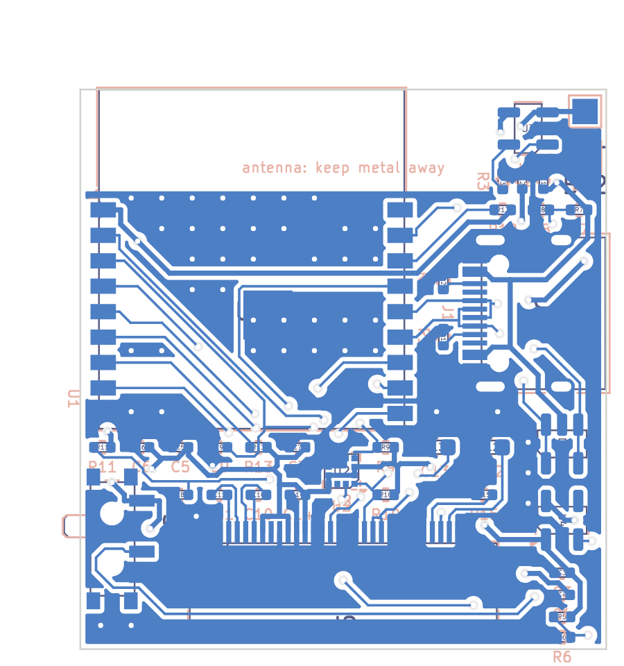
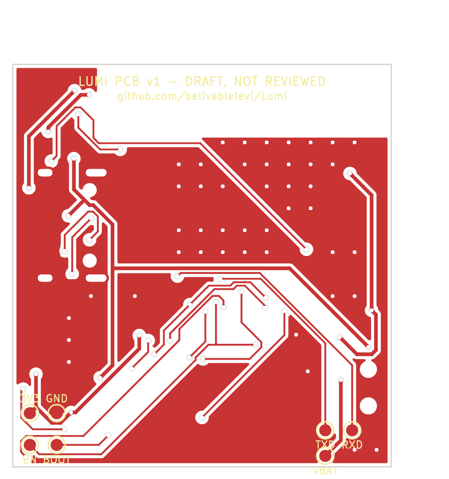

# Lumi PCB v1: draft board, review checklist, ordering and bring-up

> **Status: DRAFT, NOT REVIEWED. Don't order yet.**
>
> These files were generated and checked by software:
> - KiCad's design-rule check passes with nothing left unrouted.
> - The schematic and board match the design file pin for pin.
>
> Software can't catch a wrong pinout in a datasheet I couldn't open, a bad
> antenna layout, or a part that doesn't fit the case. Work through
> [Before you order](#before-you-order-review-checklist) first, ideally with
> someone who has designed small RF boards. An hour of review costs less
> than a batch of boards that don't work.

## What's here

| File | What it is |
|---|---|
| [`kicad/lumi/lumi.kicad_pro`](kicad/lumi/lumi.kicad_pro) | The KiCad project. Open it in KiCad 7 or newer. |
| [`kicad/lumi/lumi.kicad_sch`](kicad/lumi/lumi.kicad_sch) | Schematic, one page, grouped by function. Each pin ends in a labelled net. |
| [`kicad/lumi/lumi.kicad_pcb`](kicad/lumi/lumi.kicad_pcb) | Board layout, routed, with ground pours |
| [`kicad/fab/lumi-gerbers.zip`](kicad/fab/lumi-gerbers.zip) | Gerbers and drill files: upload this to JLCPCB |
| [`kicad/fab/lumi-bom.csv`](kicad/fab/lumi-bom.csv) | Parts list in JLCPCB's format, with LCSC part numbers |
| [`kicad/fab/lumi-cpl.csv`](kicad/fab/lumi-cpl.csv) | Part positions (pick-and-place) in JLCPCB's format |
| [`kicad/fab/lumi-schematic.pdf`](kicad/fab/lumi-schematic.pdf) | Schematic as a PDF, for reviewers without KiCad |
| [`kicad/fab/lumi.step`](kicad/fab/lumi.step) | 3D board for the case design. The module has no KiCad 3D model, so it's missing; it's an 18 × 20 × 3.2 mm box. |
| [`kicad/fab/fit.txt`](kicad/fab/fit.txt) | Height stack against the case |
| [`kicad/fab/drc-report.txt`](kicad/fab/drc-report.txt) | KiCad's design-rule check output |
| [`kicad/renders/`](kicad/renders/) | Pictures of the schematic and both sides of the board |
| [`kicad/design.py`](kicad/design.py) | **The source.** Every part and connection lives here; the schematic and board are generated from it. |

## The board at a glance

| | |
|---|---|
| Size | 31 × 33 mm, 2 layers, 1.0 mm thick |
| Parts | All on the **back**. The front is flat for the screen glass, with copper, 7 test pads and the label. |
| Antenna | Top edge (keyring end). No copper on either layer above the module's antenna line. |
| USB-C | **Left** edge seen from the front (right edge seen from the back) |
| Power switch | Right edge, lever sticking out about 1 mm |
| Screen | Its cable wraps around the **bottom** edge into a 30-pin ZIF connector on the back |
| Battery | Two solder pads in the top-left corner on the back (BT1 +, BT2 −) |
| Test pads (front) | Bottom corners, outside the glass: 3V3, GND, EN, BOOT, TXD, RXD, VBAT |





### Two changes from the plan

1. **Module: ESP32-C3-WROOM-02 instead of the MINI-1.**
   - Why: KiCad 7, the version available here, has no footprint for the MINI-1, and drawing its 53-pad footprint without the datasheet would be guesswork.
   - Same: the WROOM-02 has the same chip and the same radio certification (FCC/IC), and also comes in 4 MB.
   - Cost: it's bigger (18 × 20 × 3.2 mm vs 13.2 × 16.6 × 2.4 mm) and costs about the same. LCSC C2934560, Extended.
   - Switching back to the MINI-1 later is a footprint change in `design.py` plus a re-place.
2. **The case gets thicker: about 14.5 mm, not 12.5 mm.**
   - Why: the module and the USB-C socket are each about 3.2 mm tall, against the plan's assumed 1.5 mm for parts. See `fab/fit.txt`.
   - Ways back toward 12.5 mm, roughly in order of cost:
     - a 4 mm battery (402030, ~300 mAh): −1.4 mm,
     - a mid-mount USB-C that sinks into a board cutout: about −1.5 mm for that part, but the module still sets the height,
     - the MINI-1 (2.4 mm): −0.8 mm.

## Before you order: review checklist

Tick every box. Items marked **VERIFY** come from memory or similar parts, not from the part's own datasheet.

### Pinouts

- [ ] **ESP32-C3-WROOM-02 pin map (VERIFY).** Check `WROOM_NAMES` in `design.py` against the "Pin Definitions" table in the current Espressif datasheet.
  - Assumed: 1 3V3, 2 EN, 3 IO4, 4 IO5, 5 IO6, 6 IO7, 7 IO8, 8 IO9, 9 GND, 10 IO10, 11 RXD, 12 TXD, 13 IO18, 14 IO19, 15 IO3, 16 IO2, 17 IO1, 18 IO0, 19 GND pad.
- [ ] **OLED panel, 30 pins (VERIFY, most important).** Check `OLED` in `design.py` against the BuyDisplay ER-OLED0.96-1 datasheet.
  - Assumed: the usual SSD1306 30-pin layout in I2C mode:
    - BS0=0, BS1=1, BS2=0,
    - D0=SCL, D1+D2=SDA, D/C#=0 (address 0x3C), CS#=0, RES# to IO10,
    - IREF via 390 kΩ, VCOMH 4.7 µF, VCC 2.2 µF,
    - charge-pump caps 1 µF on C1P/C1N and C2P/C2N.
  - If the panel's pin 1 ends up at the other end of the connector, set `OLED_PIN_REVERSED = True` in `design.py` and rebuild.
- [ ] **Screen cable (VERIFY).** From the panel's mechanical drawing, check:
  - the cable is long enough to wrap the bottom edge and reach J2,
  - the contacts face the right way for J2. Hirose FH12-30S-0.5SH is **bottom-contact**.
  - **Pin 1 end:** looking at the back, pin 1 of J2 is at the right-hand end.
- [ ] **TP4054 (VERIFY):** 1 CHRG, 2 GND, 3 BAT, 4 VCC, 5 PROG.
- [ ] **RT9080-33GJ5 (VERIFY):** 1 VIN, 2 GND, 3 EN, 4 NC, 5 VOUT.
- [ ] **LIS2DH12:** 1 SCL, 2 CS, 3 SA0, 4 SDA, 5 RES (to GND), 6–8 GND, 9 VDD, 10 VDD_IO, 11 INT2, 12 INT1. This matches ST's datasheet as far as I know; still worth a glance.
- [ ] **USBLC6-2SC6:** I/O lines on 1/6 and 3/4, VBUS 5, GND 2.
- [ ] **MSK12C02 switch:** it's placed on KiCad's C&K PCM12 footprint. Check the pad layout matches the MSK12C02 drawing. Many clones copy the PCM12, but not all.

### Layout

- [ ] **Antenna:**
  - nothing metal in front of or behind the module's antenna (top ~6 mm),
  - the battery mustn't sit behind it. Make the case put the battery below the antenna line.
  - The charger and battery pads sit just left of the keep-out. A reviewer may want them further away.
- [ ] **Decoupling:** the 3.3 V pin is at the module's top-right corner, but its 10 µF/100 nF capacitors (C5, C6) sit below the module, about 14 mm away by trace. There's no room beside the pin. The module has its own on-board capacitors, so this probably works; a reviewer should still say yes or no.
- [ ] **USB data:** D+/D− go via the ESD part at the bottom left, about 25 mm of trace. Fine for 12 Mb/s USB; check the routing doesn't run beside the screen's charge-pump lines.
- [ ] **Autorouted tracks:** the routing came from an autorouter. It meets every rule, but a person would tidy it: shorter power paths, fewer vias, straighter USB pair. A reviewer may suggest touch-ups.

### Parts and stock

- [ ] Open each LCSC number in `fab/lumi-bom.csv` in JLCPCB's parts library. Check:
  - it's the right part and package,
  - it's in stock,
  - it's Basic or Extended. Each Extended part adds ~$3 per order. This board has 8: U1, U2, U3, U4, D1, J1, J2, SW1.
- [ ] Passive voltage ratings:
  - C12 (VCC, ~7.5 V) needs ≥ 16 V, 25 V better.
  - C13 (VCOMH) needs ≥ 16 V.
  - C1 (USB 5 V) needs ≥ 10 V.

### Case

- [ ] Model the case around the references in [`../enclosure/blender/`](../enclosure/blender/README.md). Blender's ready-made scene has every part, the openings and the antenna keep-out. Check:
  - the USB-C opening on the left,
  - the switch slot on the right,
  - the screen cable wrap at the bottom,
  - the ~14.5 mm depth.
- [ ] **Corners:** today's case has 7 mm rounded corners, and the board's square corners and the module's top corners don't fit inside them. The PCB case needs smaller corners (about 4 mm), or the board needs rounded corners and a re-layout.

## Ordering from JLCPCB

1. Go to jlcpcb.com, choose **Order now**, and upload `kicad/fab/lumi-gerbers.zip`.
2. Board options:
   - **Layers:** 2.
   - **Thickness:** 1.0 mm.
   - **Quantity:** 5. If you only have 5 boards assembled, extra bare boards are cheap spares.
   - **Surface finish:** HASL lead-free, or ENIG for the 0.5 mm-pitch parts (flatter pads; a few dollars more).
   - Everything else default.
3. Turn on **PCB Assembly**:
   - **Side:** **Bottom** (all parts are on the back).
   - **Quantity:** 5 (or 2 to start; see the note below).
   - **Tooling holes:** "Added by JLCPCB".
4. Upload `kicad/fab/lumi-bom.csv` (BOM) and `kicad/fab/lumi-cpl.csv` (CPL). On the parts page:
   - Every line should match its LCSC number. Fix any "out of stock" with an equivalent part.
   - The battery pads and test pads aren't in the BOM on purpose.
5. **Check the placement preview carefully.** This is where most first-order mistakes show up. On bottom-side boards, rotations are often off by 90° or 180°. For each part, check:
   - **U1 module:** antenna at the top edge, pads on the board's pads.
   - **U2, U3, U4, D1:** the pin-1 dot matches the silkscreen dot.
   - **J1 USB-C:** opening at the board edge.
   - **J2 ZIF:** opening toward the bottom edge.
   - **SW1:** lever pointing out of the right edge.

   Use JLCPCB's rotate buttons to fix anything off, and note the fix so the next order can use it.
6. Order. The screen panels (BuyDisplay) and batteries come separately.

Cost guide: see the prototype budget in [PLAN.md](PLAN.md). Expect roughly:
- $30–60 in assembly setup and Extended-part fees,
- $25–40 of parts for 5 boards,
- plus shipping.

Ordering 2 assembled boards first halves the parts cost and finds problems sooner.

## Bring-up test sheet

You need:
- a USB-C cable,
- a multimeter (ideally one that reads microamps),
- a protected 503030 cell,
- the plug-in screen.

Test in this order, and stop at the first failure.

| # | Test | How | Pass |
|---|---|---|---|
| 1 | No shorts | Before powering, measure resistance VBUS–GND, VBAT–GND and 3V3–GND | Each above ~1 kΩ (3V3 reads lower while the capacitors charge) |
| 2 | Charger | Plug in USB-C with no battery and the switch OFF. Measure VBAT (TP7). | ~4.2 V |
| 3 | Battery | Unplug USB. Solder the battery: red to BT1 (+), black to BT2 (−). Switch ON. | 3V3 test pad reads 3.25–3.35 V |
| 4 | Off really is off | Switch OFF. Measure the battery current with the meter in series. | Under ~5 µA |
| 5 | USB flashing | Switch ON, USB plugged in. In PlatformIO, upload the firmware. | Uploads. If not: short BOOT to GND, tap EN to GND, release BOOT, upload again. |
| 6 | Serial console | Open the serial monitor at 115200 | Boot log, including `IMU: LIS2DH12 at 0x19` |
| 7 | Screen | Fit the screen cable into J2 and close the latch, then reset | Lumi's face. If blank, check pin 1 orientation (`OLED_PIN_REVERSED`) and the I2C scan in the log (expect 0x3C and 0x19). |
| 8 | Accelerometer axes | Console `i` command, tilt the board | Tilting toward the screen's top raises Y; work out any remap for `config.h` |
| 9 | Pats and wake | Pat the case. Let it sleep, then pick it up. | Reacts to pats; wakes on pickup |
| 10 | Charging | Plug USB in with the battery fitted | The battery screen says "charging"; VBAT rises toward 4.2 V |
| 11 | Sleep current | Let it deep-sleep, meter in series with the battery | Target under 30 µA total |
| 12 | Radio | Pair with the phone app, walk 5–10 m away | Stays connected. If range is poor, see the antenna items above. |

Send me the serial log and the numbers from tests 4 and 11, and I'll go through them with you.

**Firmware for this board.** The pins match today's XIAO build:
- unchanged: SDA 6, SCL 7, motion interrupt 3, battery 4,
- new: USB sense on IO5, the screen reset on IO10, the charger status on IO1 (with pull-up).

A `lumi_pcb_v1` build environment that sets these is the next firmware step (PLAN.md, "Firmware changes", items 2–4). Until then the XIAO build runs as-is, except that the screen needs IO10 driven high for its reset line.

## Rebuilding the files

Everything is generated from [`kicad/design.py`](kicad/design.py). Change parts or connections there, never in the KiCad files, and rebuild:

```sh
# Needs KiCad 7+, Java 21+ and the Freerouting 2.1 jar.
FREEROUTING=~/freerouting-2.1.0.jar hardware/pcb/kicad/build.sh

# Re-run only the checks and factory files on the committed routing:
hardware/pcb/kicad/build.sh --no-route
```

Placement is in `PLACE` in [`kicad/gen_board.py`](kicad/gen_board.py) (millimetres, seen from the front). Routing is done by Freerouting. If you hand-route in KiCad instead, use `--no-route` from then on so your work isn't overwritten.

The build fails unless all three checks pass:
- the schematic's netlist matches `design.py`,
- every board pad carries the right net,
- KiCad's DRC reports no violations and nothing unrouted.

KiCad 7's command line has no ERC/DRC commands, so `check.py` runs them through KiCad's Python module.
